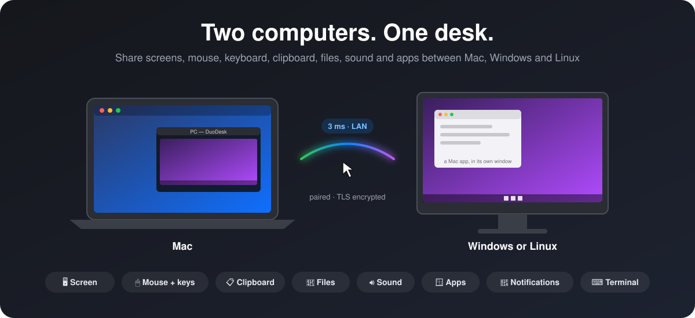
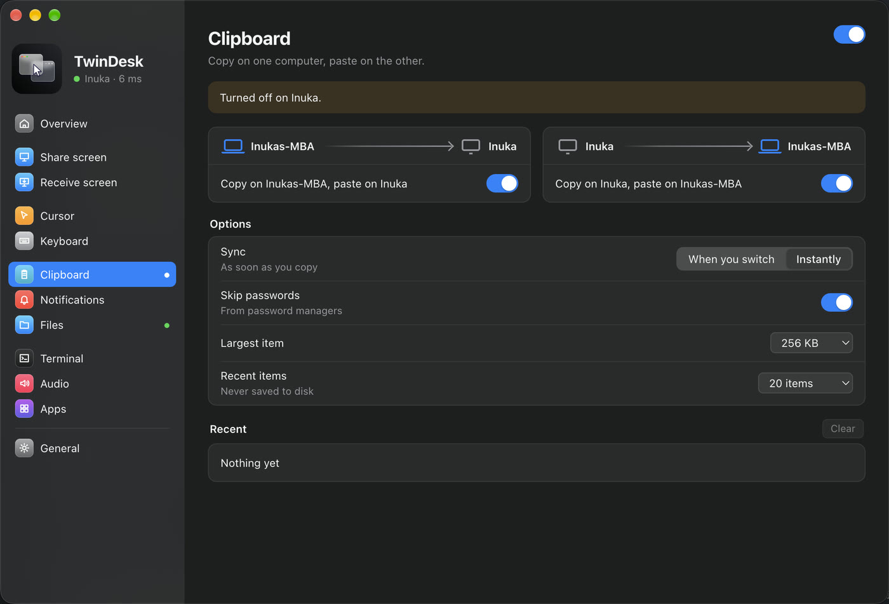
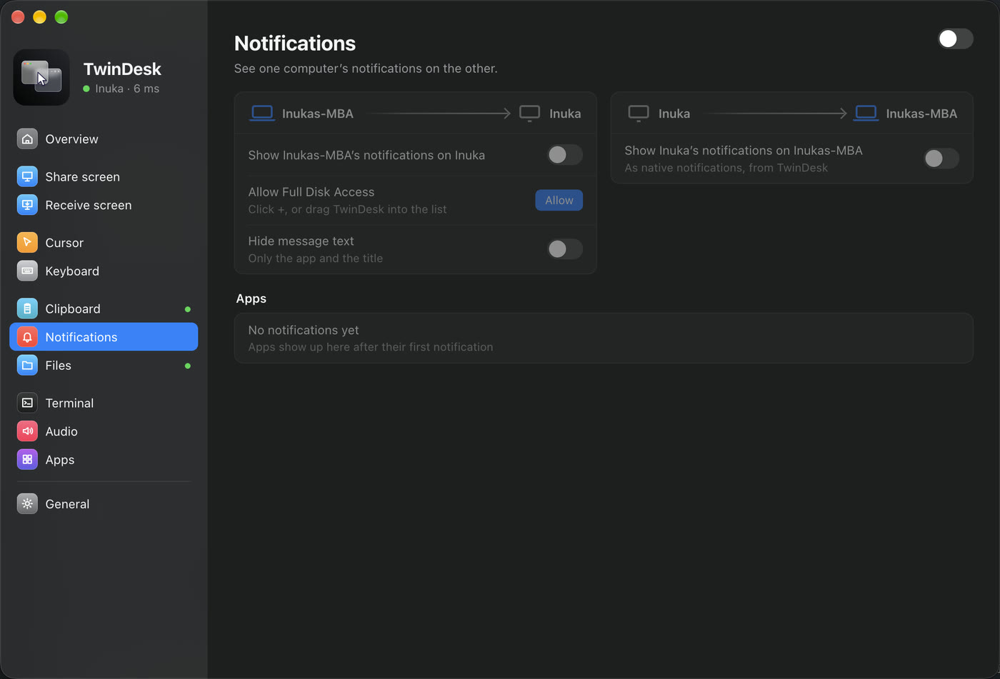
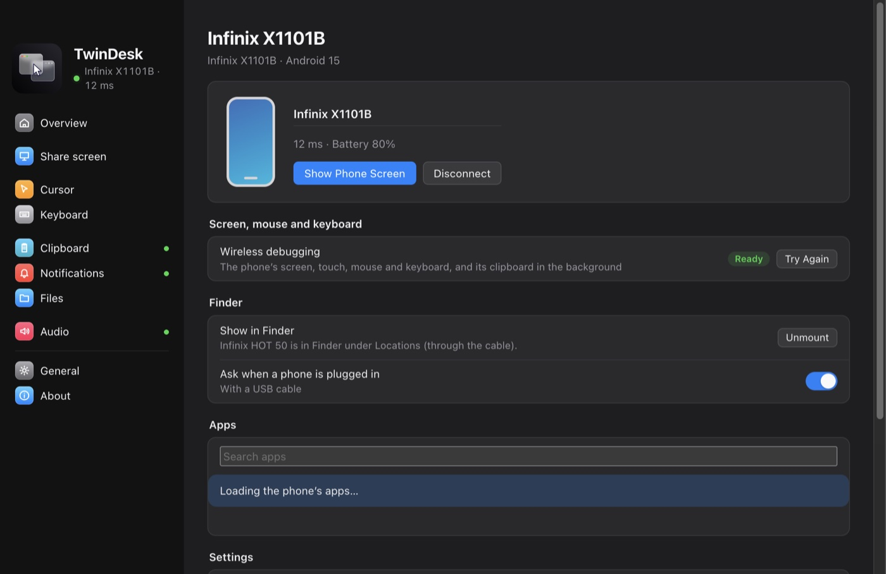
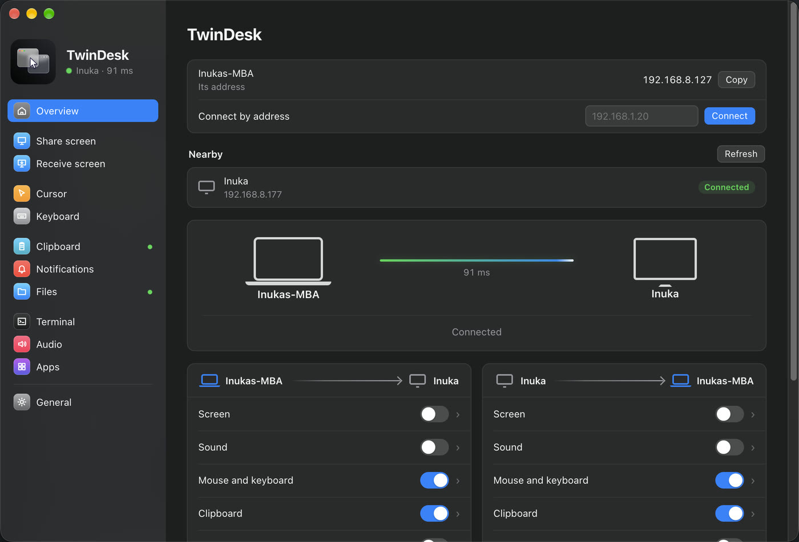

<p align="center">
  
</p>

<h1 align="center"><a href="https://twin-desk.vercel.app">TwinDesk</h1></a>

<p align="center">
  Use two computers as one desk: Mac, Windows and Linux on the same network. <b>And your Android phone, as a full peer.</b><br>
  Share screens, mouse and keyboard, clipboard, files, sound, notifications, terminals and apps.
</p>

<p align="center">
  
  
  
  
  
</p>


<p align="center">
  
</p>

TwinDesk pairs two computers on your local network. One app on each side does the job of a
software KVM, a second-monitor app, a clipboard and file-sharing tool and a remote-app viewer.
Everything travels directly between the two machines over an encrypted link. There's no cloud
account and no relay server.

## 📱 Your Android phone is the other computer

Most phone links stop at notifications and a file drop. In TwinDesk the phone is a **full peer**:
it pairs like a computer, takes the session like a computer, and gets the same features. Your
mouse leaves the Mac's screen edge and keeps going on the phone. The phone's apps open in windows of
their own on your desktop. A file copied on the Mac pastes in any Android app. And it works with a
**Mac, a Windows PC or a Linux computer**, with no cable, no root and no account.

| On the computer | On the phone |
|---|---|
| **The phone's screen in a window**, with touch from your mouse and trackpad, and the phone's sound | **The computer's screen on the phone**: Mirror it, or Extend the desktop onto it, with touch as the mouse |
| **Phone apps in windows of their own**, side by side with your desktop apps. Pin them to the Dock or the Start menu | **The computer's mouse and keyboard on the phone**: push the pointer past the screen edge, type with the real keyboard |
| **Your mouse and keyboard across the edge**, onto the phone and back, with a double-tap of the hotkey to bring everything home | **Files from any app** through the share sheet: *Send to computer* or *Copy to computer* |
| **Copy files on the computer** (<kbd>⌃⌥C</kbd>, <kbd>Ctrl+Alt+C</kbd>) and paste them in any Android app from the phone's notification | **The clipboard both ways**, in the background too (Quick Settings has a *Send clipboard* tile) |
| **The phone's notifications** as native notifications, with the text hidden or apps muted if you like | **The computer's notifications** on the phone |
| **The phone in Finder** on a Mac, like a network drive | **The computer's sound** on the phone, and the phone's sound on the computer |

A paired phone nearby shows above Overview with its own wallpaper; one click connects it. It holds
the session while it's connected, and gets it back by itself after a Wi-Fi blip. Everything that
needs system access (the screen, input, apps and sound) goes through Android's own wireless
debugging, which TwinDesk pairs with once and then keeps on by itself. See [Android](#android).

<p align="center">
  
</p>

## What you can do

| | |
|---|---|
| **🖥 Use one computer as a second screen**<br>Extend your Mac onto the PC with a real virtual display, or mirror it. Or bring the PC's screen into a window on the Mac, with Extend through a virtual display driver. Low-latency H.264 over WebRTC, with Fastest / Smooth playback and optional frame generation. |  |
| **🖱 One mouse and keyboard for both**<br>Push the pointer off the edge of the screen and keep working on the other computer. Pick which side the other computer is on, set edge resistance and pointer speed. Double-tap the hotkey (Right Option / Right Alt by default) to bring everything home. Trackpad gestures, like Spaces swipes, pinch to zoom and show desktop, carry over too. |  |
| **📋 Clipboard both ways**<br>Copy on one computer and paste on the other, instantly or when you switch. Password managers' entries are skipped, and there's a short Recent list. |  |
| **📁 Files and folders**<br>Drag files across the screen edge and drop them anywhere, or copy with <kbd>⌃⌥C</kbd> and paste with <kbd>⌃⌥V</kbd> (<kbd>Ctrl+Alt+C/V</kbd> on Windows). You can also send from the macOS Share menu or Explorer's *Send to*, and share a folder that shows up as a network drive on the other side. |  |
| **🪟 Apps from the other computer**<br>Open the PC's apps on the Mac (or the Mac's apps on the PC), each in its own window with its own Dock icon or Start-menu pin. Menus and pop-ups work too. |  |
| **🔔 Notifications**<br>See one computer's notifications on the other as native notifications. You can hide the message text or mute single apps. |  |
| **⌨️ Terminal**<br>Open a shell on the other computer without passwords, between any two computers. Keys are exchanged over the paired link, so `ssh twindesk` just works in any terminal. |  |
| **🔊 Sound**<br>Hear one computer on the other, in either direction, separate from screen sharing. |  |
| **📱 Your Android phone**<br>Pair an Android phone and it works like another computer: files from the share sheet, the clipboard, notifications both ways, and through wireless debugging its screen and apps in windows of their own, with your mouse and keyboard across the screen edge. On a Mac, mount it in Finder from the Mount tab. |  |

TwinDesk also includes:

- **Discovery and pairing.** Computers find each other on the LAN. You pair once by comparing a
  code, and after that the link is TLS-encrypted and pinned to the pair.
- **Settings stay in sync.** A two-way switch is one setting shared by both computers, remembered
  per pair.
- **Wake-on-LAN.** Wake a paired computer from the other one.
- **Device names.** Every label uses your computers' real names.
- **Update checks.** Each app looks for new [releases](https://github.com/InukaAsith/TwinDesk/releases)
  on start and every few hours, shows a notification and offers the download for your platform
  (About › Updates, or the menu bar / tray).

<p align="center">
  
</p>

## Platforms

| Pair | Status |
|---|---|
| Mac ↔ Windows PC | Every feature above |
| Mac ↔ Mac | Every feature above |
| PC ↔ PC | Every feature above |
| Linux ↔ Mac, PC or Linux | Every feature above (see the notes below) |
| Android phone ↔ Mac, PC or Linux | Files, clipboard, notifications, sound, the phone's screen and apps, mouse and keyboard (see [Android](#android)) |

On Linux, TwinDesk runs on both X11 and Wayland. On Wayland, the mouse and keyboard go through
evdev and uinput (the Setup screen grants access once), and screens are captured through the
desktop portal. A few things work a little differently:

- **Shared folder.** Sharing uses Samba. The first time, one password prompt installs it if it's
  missing and adds a network-only account. The other computer's folder is connected with GVFS
  and shows in the file manager's sidebar.
- **Copy and paste files.** <kbd>Ctrl+Alt+C</kbd> copies what's selected in the file manager in
  front (or files you already copied), and <kbd>Ctrl+Alt+V</kbd> pastes into the file manager
  window in front (else Downloads). Right-click › *Send to* works in Nautilus, Nemo, Caja,
  Dolphin and Thunar.
- **Dragging files across the edge.** Files dragged in from the other computer are dropped into
  the folder under the pointer, or the desktop. On Wayland, they go to the file manager window in
  front. Dragging files out of Linux needs an Xorg session.
- **Extend.** On GNOME (Wayland) it uses Mutter's own virtual monitor; pick "Virtual remote
  monitor" when the desktop asks which screen to share. On X11 it uses a spare output of the
  graphics driver (not available on NVIDIA's driver).
- **Apps.** Opening this computer's apps on the other side needs an Xorg session.
- **Android phone.** Everything in [Android](#android) works on Linux too: the phone's screen and
  apps in windows, the mouse and keyboard across the edge, files, clipboard, notifications and
  sound. The package carries adb; the Setup screen's firewall fix opens mDNS (5353/udp) so the
  phone's wireless debugging is found.

## Android

Install TwinDesk on the phone (from the [releases](https://github.com/InukaAsith/TwinDesk/releases)),
open it next to TwinDesk on the computer and pair from Overview › Nearby. A paired phone nearby
shows above Overview on the computer; click it to connect. It works the same with a Mac, a Windows
PC (x64 or ARM) and Linux (X11 or Wayland). The phone needs Android 10, and Android 11 for
everything that goes through wireless debugging.

### The phone app

The app is laid out like the computers' (a sidebar on tablets, tabs at the bottom on phones), and
every page names the computer it's connected to:

| Page | What it does |
|---|---|
| **Overview** | The computer you're connected to, Connect and Disconnect, nearby computers to pair with, and the wireless debugging card until that's set up |
| **Screen** | Use the phone as a screen for the computer: Mirror, or Extend the desktop onto it. Touch works as the mouse (tap to click, hold to right click, drag to select or move windows, two fingers to scroll), with the computer's sound and Smooth playback |
| **Cursor** | The computer's mouse on the phone across the screen edge, its pointer speed here, reverse scrolling, right and middle click |
| **Keyboard** | The computer's keyboard types on the phone, every key as a key, so any layout works and the soft keyboard stays out of the way. A keyboard on the phone types on the computer |
| **Clipboard** | Copy on one, paste on the other, each way on its own switch, at once or when sent |
| **Notifications** | The phone's notifications on the computer, with the text hidden if you like, and the computer's on the phone |
| **Files** | Send files, copy them to paste on the computer, and see where the computer's files land |
| **Sound** | The phone's sound on the computer, and the computer's sound on the phone |
| **General** | The phone's name, background running, and the permissions TwinDesk uses, each with its switch |
| **About** | Source code, releases, the license, and what goes over wireless debugging and the network |

And outside the app:

- **Share sheet:** *Send to computer* and *Copy to computer* in every app's Share menu.
- **Quick Settings tiles:** *Send clipboard* and *Wireless debugging*.
- **Home screen shortcuts:** the computer's screen, and wireless debugging on in one tap.
- **The ongoing notification** shows what's connected, with Exit.
- **Copied on the computer:** files copied with <kbd>⌃⌥C</kbd> / <kbd>Ctrl+Alt+C</kbd> arrive as a
  notification with Copy (paste them in any app) and Save.
- **The computer can install the full app** over wireless debugging (Phone page › Notifications
  from the phone): Play Protect blocks downloaded apps that read notifications, so the download
  leaves that out and the computer adds it. Settings and pairing stay.

### Wireless debugging

Files, the clipboard and notifications work right away. The phone's screen, its apps in windows,
touch, your mouse and keyboard on the phone and its sound go through **wireless debugging**, which
TwinDesk pairs with once:

<p align="center">
  
</p>

- Until it's paired, a card under the connected computers on Overview (on the computer and on the
  phone) walks you through it. Open *Developer options › Wireless debugging › Pair device with
  pairing code* on the phone and type the 6-digit code on the computer, or on the phone in
  TwinDesk's notification (Settings' dialog stays open). The phone sends the code to whichever
  computer it's connected to: Mac, PC or Linux.
- After that TwinDesk switches wireless debugging on by itself when it needs it, follows it to its
  new port every time it restarts, and keeps the pairing from expiring (Android otherwise forgets
  a computer after 7 days unused). Phones that switch it off on every Wi-Fi change or screen lock
  (MIUI, HyperOS) get it switched back on as soon as they're unlocked, or a prompt if they refuse.
  Wireless debugging only runs while **USB debugging** is on too, so TwinDesk turns both on.
- **Xiaomi, Redmi and POCO** also need *Developer options › USB debugging (Security settings)* for
  touch, mouse and keyboard (it asks for a Mi account). Without it the screen shows but input is
  refused; the computer's Phone page says "Touch blocked" until it's on.
- **On a Mac, the phone in Finder.** Turn it on in the Mount tab and click Mount: the phone shows
  under Locations like any server. Until then TwinDesk never looks at the phone's files. It goes
  through the cable when USB debugging is allowed, else over wireless debugging. Finder's `.DS_Store` and `._` files never land on the phone.

## How it works

<p align="center">
  
</p>

Each computer runs an **Electron app**, which handles the window, pairing, the link and the state
machines. Next to it runs a small **native helper** for everything the OS keeps to itself:
capturing and injecting input, virtual displays, gestures, window capture and native drag and drop.

| Folder | What's in it |
|---|---|
| `mac/` | macOS app (Electron) |
| `mac-helper/` | macOS helper (Swift): virtual display, event tap, input injection, audio, apps, SMB |
| `windows/` | Windows app (Electron) and installer |
| `windows-helper/` | Windows helper (C#): hooks, SendInput, Raw Input touchpad, window capture, native drag |
| `linux/` | Linux app (Electron) |
| `linux-helper/` | Linux helper (C): XInput2 / XTest on X11, evdev / uinput on Wayland, XRandR, window list, XDND edge strip |
| `android/` | Android app (Kotlin, Jetpack Compose); the computers drive the phone through adb and [scrcpy](https://github.com/Genymobile/scrcpy)'s server |
| `shared/` | Wire protocol, frame generation and icons used by every app |

Ports: TCP **47800** (control link) and UDP **47801** (discovery) on the local network.

## Build and run

You need [Node.js](https://nodejs.org) 18+ on every platform.

### macOS (13 Ventura or later)

```sh
xcode-select --install          # Swift compiler for the helper
cd mac
npm install
npm run build:helper
npm start                       # run from source
npm run dist && npm run dmg     # build TwinDesk.app and TwinDesk.dmg in mac/dist/
```

On first launch, TwinDesk asks for **Screen Recording**, **Accessibility** and **Input
Monitoring** (once; after that the General tab shows each permission's status).

`npm run dist` signs the app with a certificate of its own, made the first time in
`~/.twindesk-signing` (keep a backup). macOS keeps permissions per signature, so with the same
certificate they carry over when an update is dragged into Applications. An app built without it is
signed ad-hoc, and macOS treats every update as a new app; TwinDesk then clears the stale entries so
Allow works again.

### Windows 10 / 11

```bat
cd windows
npm install
npm run build:helper            :: uses the .NET Framework C# compiler that ships with Windows
npm start
npm run dist                    :: NSIS installer in windows\dist\
npm run dist -- arm64           :: the Windows on ARM installer (or `x64 arm64` for both)
```

`npm run dist` also works on a Mac or Linux: it skips the helper build and packages the
`macshare-winhelper.exe` already in `windows-helper\bin\` (for example, one taken from a release).

The installer adds the firewall rules (for every network profile, so a standard account on a
Public network doesn't need an administrator later). The Setup screen, shown once, offers to fix
the firewall if something changed (that needs an administrator) and to install the optional Virtual
Display Driver for Extend.

### Linux (X11 or Wayland)

```sh
sudo apt install build-essential libx11-dev libxi-dev libxtst-dev libxrandr-dev libxfixes-dev
cd linux
npm install
npm run build:helper
npm start
npm run dist                    # AppImage and .deb in linux/dist/
```

The Setup screen walks you through the rest. On Wayland that means input access (one admin
prompt, then log out and back in once). It can also install OpenSSH for the terminal. Extend on
GNOME Wayland uses Python 3 with GObject and GStreamer's PipeWire plugin (`python3-gi`,
`gstreamer1.0-pipewire`), which GNOME desktops already have.


#### Testing the Linux app from a Mac

`linux/scripts/vm-test.sh` runs it in a [Parallels Desktop](https://www.parallels.com) Linux VM
(Ubuntu with the packages above and Node.js): it copies this checkout into the VM, builds the
helper, starts TwinDesk in the VM's desktop session and drives it from the Mac.

```sh
linux/scripts/vm-test.sh start            # sync, build and (re)start it in the VM
linux/scripts/vm-test.sh shot linux.png   # screenshot of its window
linux/scripts/vm-test.sh eval "UI.go('cursor')"
linux/scripts/vm-test.sh log
```

On the VM's shared network it finds the Mac's TwinDesk and pairs like any Linux computer.

### Android

```sh
cd android
./gradlew assembleRelease        # JDK 17+; app/build/outputs/apk/{standard,full}/release/
```

`standard` is the build people download. `full` adds notification access, which Play Protect
blocks in downloaded apps; the computers install it over wireless debugging (Phone page ›
Notifications from the phone), so `npm run dist` on each platform bundles the newest
`android/dist/*-full.apk`.

### GitHub Actions

**Build Android**, **Build Linux** and **Build Windows** (Actions tab › Run workflow) make the
standard and full APKs, the AppImage and .deb, and the x64 and arm64 installers, helpers included.
Set the `ANDROID_KEYSTORE` secret to the key the Android app is signed with
(`base64 -i ~/.android/debug.keystore`): the APKs then install over existing ones, and the Linux and
Windows builds carry the full Android app. Without it the APKs get the runner's own key and the
computers' builds leave the Android app out.

## Privacy

TwinDesk only talks to computers you have paired with, directly over your local network. It has no
accounts, telemetry or cloud relay. The only internet request is the update check, which asks
GitHub's public API for the latest release (it can be turned off in About › Updates).
Shared-folder passwords are random and kept in the OS keychain (macOS) or encrypted with DPAPI
(Windows).

## License

TwinDesk is free software, licensed under the [GNU General Public License v3.0](LICENSE).
Copyright © 2026 inukaasith.

Parts are adapted from [DeskPad](https://github.com/Stengo/DeskPad) (MIT). See [THIRD_PARTY_NOTICES](THIRD_PARTY_NOTICES)
for details.
