<p align="center">
  
</p>

<h1 align="center"><a href="https://twin-desk.vercel.app">TwinDesk</a></h1>

<p align="center">
  <b>Your computer, your phone and your tablet: one desk.</b><br>
  Screens, apps, files, clipboard, notifications, mouse and keyboard, shared between every device you own.<br>
  Mac, Windows, Linux and Android. Free and open source.
</p>

<p align="center">
  <a href="https://github.com/InukaAsith/TwinDesk/releases"><b>⬇️ Download</b></a> ·
  <a href="https://twin-desk.vercel.app"><b>Website</b></a> ·
  <a href="#under-the-hood"><b>How it works</b></a>
</p>

<p align="center">
  
  
  
  
  
</p>

<p align="center">
  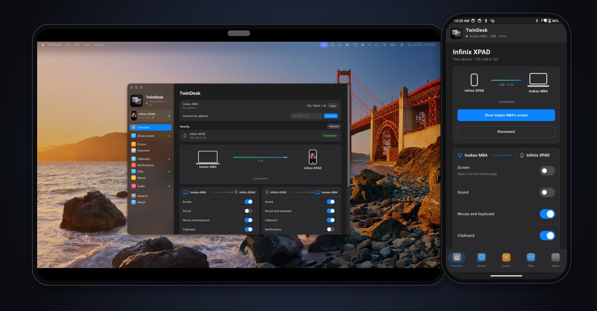
</p>

<p align="center"><i>The Mac's desktop extended onto an Android tablet, with TwinDesk on a phone next to it. Every screenshot here is from the real app.</i></p>

---

Your devices are good at their own jobs and bad at working together. TwinDesk fixes that.
Your **Android phone or tablet** becomes a second screen, its apps open as windows on your
computer, a file goes across in two taps, and what you copy on one device pastes on the other.
It works the same between **two computers**: Mac, Windows or Linux, in any combination.

- **No account, no cloud.** Devices talk directly over your Wi-Fi or a USB cable, on an encrypted link.
- **No root, no extra hardware.** Install the app on each device and pair once.
- **Every platform.** Mac ↔ Android, Windows ↔ Android, Linux ↔ Android, and any two computers.

## 📱 Your phone, right on your desktop

See your phone's screen in a window and control it with your mouse, trackpad and keyboard. Better
still, open **single Android apps in windows of their own**, side by side with your desktop apps.
Pin them to the Dock or the Start menu and use them like any other app.

<p align="center">
  
</p>

Every app on the phone is one click away from the computer's Phone page, along with its battery,
the connection and a button to bring up the whole screen.

<p align="center">
  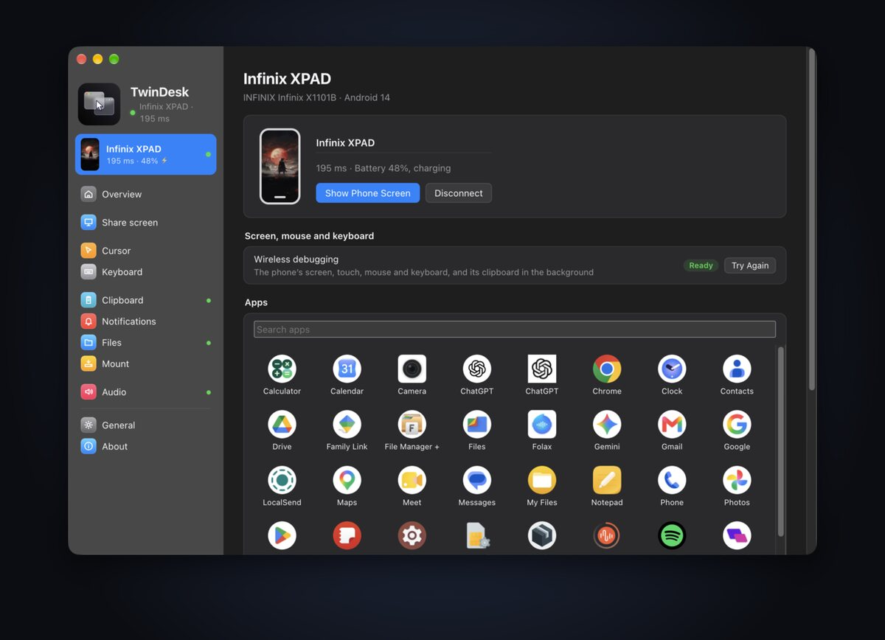
</p>

## 🖥 A second screen you already own

Turn a tablet or phone into an **extra monitor**. Choose **Extend** to get more desktop space, or
**Mirror** to show what's on your screen. Drag windows onto it, and use touch as the mouse: tap to
click, hold to right click, two fingers to scroll. Start it from the computer or from the tablet
itself.

<p align="center">
  
</p>

## 📤 Sharing as easy as AirDrop, between every device

Share a photo or a document from **any Android app**: pick *Send to computer* or *Copy to computer*
in the system share menu. On the computer, use the **macOS Share menu**, **Explorer's Send to**, drag
files across the screen edge, or press <kbd>⌃⌥C</kbd> / <kbd>Ctrl+Alt+C</kbd> to copy them and paste
them anywhere on the phone. Files arrive with a notification you can tap to open.

<p align="center">
  
</p>

## 📋 Copy here, paste there

Copy text on your computer and paste it on your phone, or the other way around. It's instant, it
works in the background, and passwords from password managers are left out. A **Recent** list on
both sides keeps the last few things you copied, and a Quick Settings tile sends the phone's
clipboard with one tap.

<p align="center">
  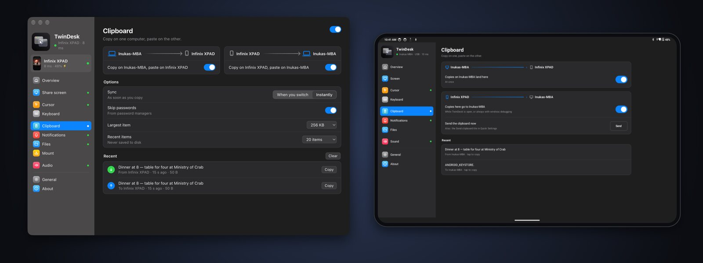
</p>

## 🖱 One mouse and keyboard for everything

Push the pointer past the edge of your screen and it **carries on onto the phone or the other
computer**. Type with your real keyboard on the phone, scroll with your trackpad, then double-tap a
hotkey to bring everything home. Set which side each device sits on, edge resistance and pointer
speed.

<p align="center">
  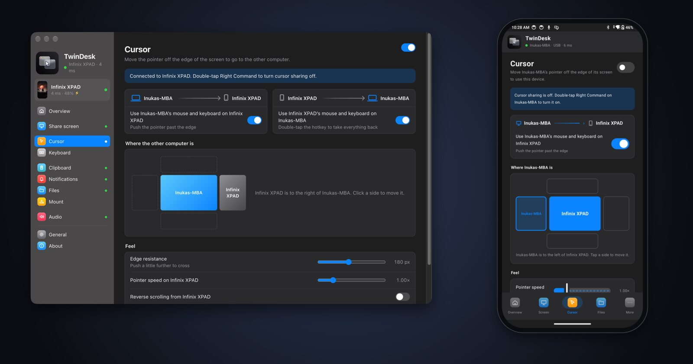
</p>

## 🔔 Never miss a notification

Your phone's notifications show up on your computer as **native notifications**, and the
computer's can show up on your phone. Hide the message text for privacy or mute single apps.

<p align="center">
  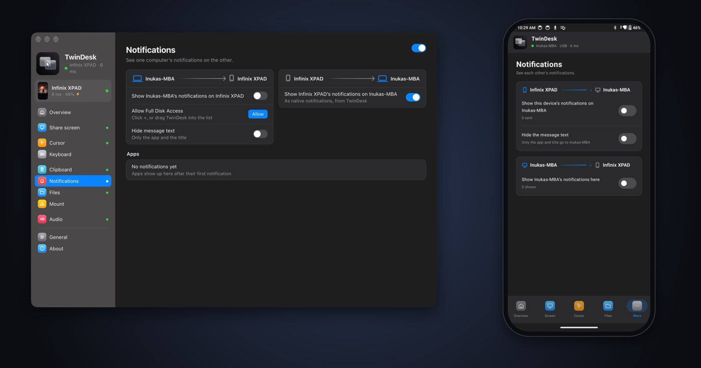
</p>

## 🔌 Wi-Fi or USB cable, your choice

TwinDesk finds your devices on the network by itself and reconnects after a Wi-Fi drop. Plug in a
**USB cable** and it switches over for even lower latency (single-digit milliseconds), then back to
Wi-Fi when you unplug. The current link and its latency are always shown at the top of the app.

## 📲 Made for phones and tablets

The Android app adapts to the device: tabs at the bottom on a phone, a full sidebar on a tablet.
Every page names the computer you're connected to and shows what's shared in each direction.

<p align="center">
  
</p>

<p align="center">
  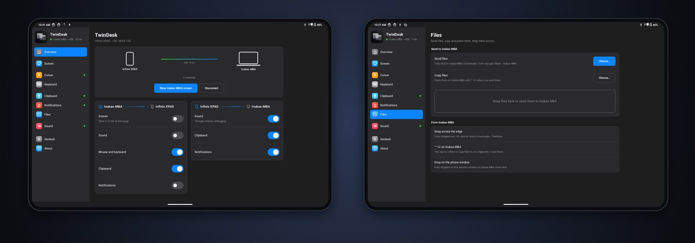
</p>

You also get **Quick Settings tiles** (*Send clipboard*, *Wireless debugging*), **home screen
shortcuts** to the computer's screen, an ongoing notification with what's connected, and **sound**
in both directions.

## 💻 And between two computers

Everything above works between computers too: a Mac and a PC, two Macs, two PCs, or Linux with
any of them.

| | |
|---|---|
| **🖥 Second screen**<br>Extend your Mac onto the PC with a real virtual display, or mirror it. Or bring the PC's screen into a window. Low-latency H.264 with Fastest / Smooth playback and optional frame generation. | 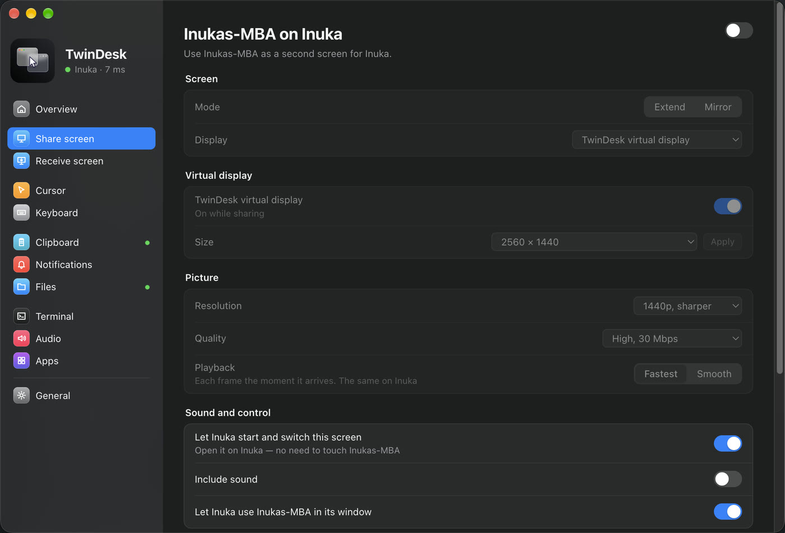 |
| **🖱 One mouse and keyboard**<br>Push the pointer off the edge and keep working. Trackpad gestures like Spaces swipes, pinch to zoom and show desktop carry over too. | 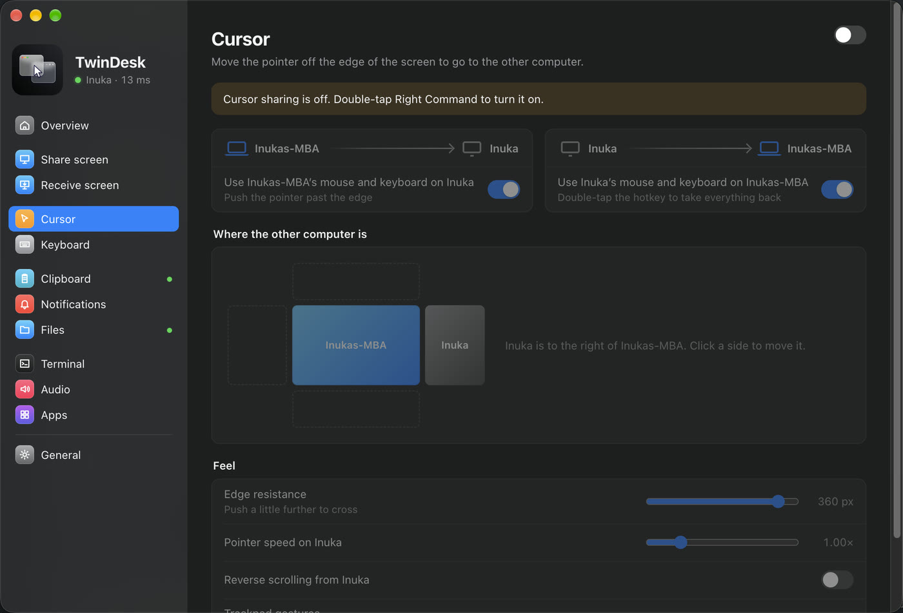 |
| **📁 Files and folders**<br>Drag files across the edge, copy and paste them with a shortcut, or share a folder that appears as a network drive on the other side. | 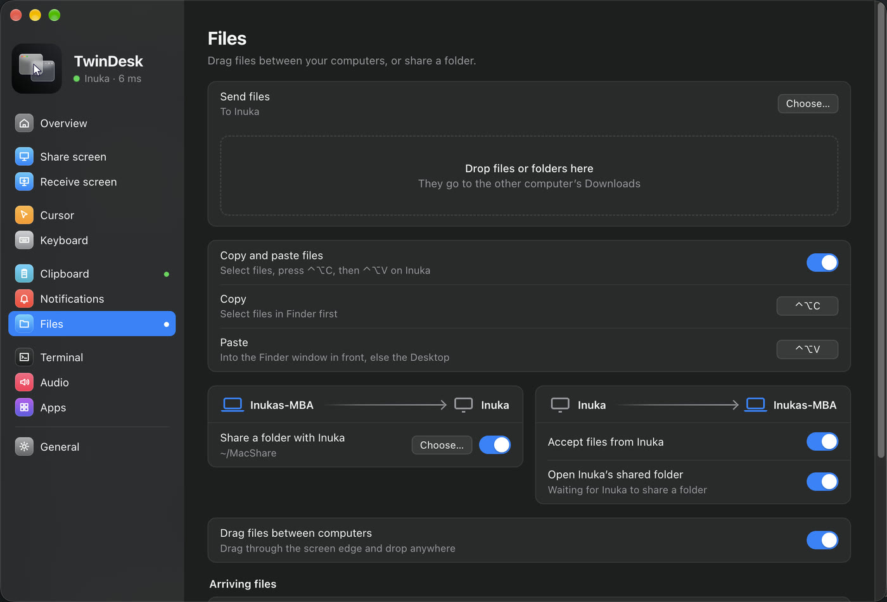 |
| **🪟 Apps from the other computer**<br>Open the PC's apps on the Mac (or the Mac's on the PC), each in its own window with its own Dock icon or Start-menu pin. | 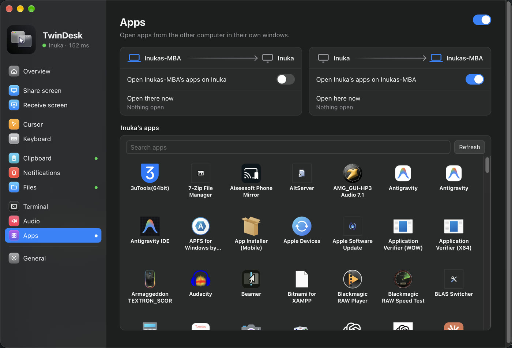 |
| **⌨️ Terminal**<br>Open a shell on the other computer without passwords. `ssh twindesk` just works in any terminal. | 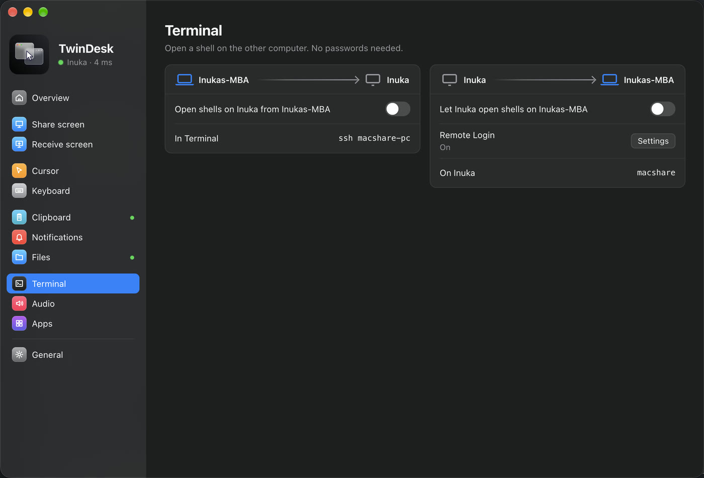 |
| **🔊 Sound**<br>Hear one computer on the other, in either direction. | 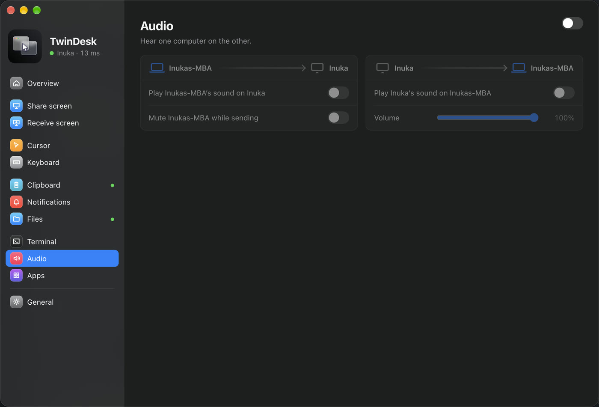 |

Plus Wake-on-LAN, settings that stay in sync on both sides, and update checks that offer the right
download for your platform.

<p align="center">
  
</p>

## Works with

| Pair | What you get |
|---|---|
| Android ↔ Mac, Windows or Linux | Screen and apps in windows, second screen, mouse and keyboard, files, share menu, clipboard, notifications, sound |
| Mac ↔ Windows PC | Everything |
| Mac ↔ Mac | Everything |
| PC ↔ PC | Everything |
| Linux ↔ Mac, PC or Linux | Everything ([a few differences](#linux)) |

## Get started

1. **Download** TwinDesk for your computer and phone from the [releases](https://github.com/InukaAsith/TwinDesk/releases).
2. **Open it on both.** They find each other on the same Wi-Fi (or over a USB cable).
3. **Pair once** by comparing a code. That's it: from then on they connect by themselves.

For the phone's screen, apps, touch and mouse, TwinDesk walks you through turning on Android's
wireless debugging once ([details](#wireless-debugging)). Files, clipboard and notifications work
right away.

## Privacy

TwinDesk only talks to devices you've paired with, directly over your own network or cable. There
are no accounts, no telemetry and no cloud relay. The only internet request is an update check
against GitHub's public releases, which you can turn off.

<br>

---

# Under the hood

Everything below is for the curious and for people building TwinDesk themselves.

## Linux

On Linux, TwinDesk runs on both X11 and Wayland. On Wayland, the mouse and keyboard go through
evdev and uinput (the Setup screen grants access once), and screens are captured through the
desktop portal. A few things work a little differently:

- **Shared folder.** Sharing uses Samba. The first time, one password prompt installs it if it's
  missing and adds a network-only account. The other computer's folder is connected with GVFS
  and shows in the file manager's sidebar.
- **Copy and paste files.** <kbd>Ctrl+Alt+C</kbd> copies what's selected in the file manager in
  front (or files you already copied), and <kbd>Ctrl+Alt+V</kbd> pastes into the file manager
  window in front (else Downloads). Right-click › *Send to* works in Nautilus, Nemo, Caja,
  Dolphin and Thunar.
- **Dragging files across the edge.** Files dragged in from the other computer are dropped into
  the folder under the pointer, or the desktop. On Wayland, they go to the file manager window in
  front. Dragging files out of Linux needs an Xorg session.
- **Extend.** On GNOME (Wayland) it uses Mutter's own virtual monitor; pick "Virtual remote
  monitor" when the desktop asks which screen to share. On X11 it uses a spare output of the
  graphics driver (not available on NVIDIA's driver).
- **Apps.** Opening this computer's apps on the other side needs an Xorg session.
- **Android phone.** Everything in [Android](#android-in-detail) works on Linux too: the phone's screen and
  apps in windows, the mouse and keyboard across the edge, files, clipboard, notifications and
  sound. The package carries adb; the Setup screen's firewall fix opens mDNS (5353/udp) so the
  phone's wireless debugging is found.

## Android in detail

Install TwinDesk on the phone, open it next to TwinDesk on the computer and pair from Overview › Nearby. The phone needs Android 10, and Android 11 for everything that goes through wireless debugging.

### The phone app

The app is laid out like the computers' (a sidebar on tablets, tabs at the bottom on phones), and
every page names the computer it's connected to:

| Page | What it does |
|---|---|
| **Overview** | The computer you're connected to, Connect and Disconnect, nearby computers to pair with, and the wireless debugging card until that's set up |
| **Screen** | Use the phone as a screen for the computer: Mirror, or Extend the desktop onto it. Touch works as the mouse (tap to click, hold to right click, drag to select or move windows, two fingers to scroll), with the computer's sound and Smooth playback |
| **Cursor** | The computer's mouse on the phone across the screen edge, its pointer speed here, reverse scrolling, right and middle click |
| **Keyboard** | The computer's keyboard types on the phone, every key as a key, so any layout works and the soft keyboard stays out of the way. A keyboard on the phone types on the computer |
| **Clipboard** | Copy on one, paste on the other, each way on its own switch, at once or when sent |
| **Notifications** | The phone's notifications on the computer, with the text hidden if you like, and the computer's on the phone |
| **Files** | Send files, copy them to paste on the computer, and see where the computer's files land |
| **Sound** | The phone's sound on the computer, and the computer's sound on the phone |
| **General** | The phone's name, background running, and the permissions TwinDesk uses, each with its switch |
| **About** | Source code, releases, the license, and what goes over wireless debugging and the network |

And outside the app:

- **Share sheet:** *Send to computer* and *Copy to computer* in every app's Share menu.
- **Quick Settings tiles:** *Send clipboard* and *Wireless debugging*.
- **Home screen shortcuts:** the computer's screen, and wireless debugging on in one tap.
- **The ongoing notification** shows what's connected, with Exit.
- **Copied on the computer:** files copied with <kbd>⌃⌥C</kbd> / <kbd>Ctrl+Alt+C</kbd> arrive as a
  notification with Copy (paste them in any app) and Save.
- **The computer can install the full app** over wireless debugging (Phone page › Notifications
  from the phone): Play Protect blocks downloaded apps that read notifications, so the download
  leaves that out and the computer adds it. Settings and pairing stay.

### Wireless debugging

Files, the clipboard and notifications work right away. The phone's screen, its apps in windows,
touch, your mouse and keyboard on the phone and its sound go through **wireless debugging**, which
TwinDesk pairs with once:

<p align="center">
  
</p>

- Until it's paired, a card under the connected computers on Overview (on the computer and on the
  phone) walks you through it. Open *Developer options › Wireless debugging › Pair device with
  pairing code* on the phone and type the 6-digit code on the computer, or on the phone in
  TwinDesk's notification (Settings' dialog stays open). The phone sends the code to whichever
  computer it's connected to: Mac, PC or Linux.
- After that TwinDesk switches wireless debugging on by itself when it needs it, follows it to its
  new port every time it restarts, and keeps the pairing from expiring (Android otherwise forgets
  a computer after 7 days unused). Phones that switch it off on every Wi-Fi change or screen lock
  (MIUI, HyperOS) get it switched back on as soon as they're unlocked, or a prompt if they refuse.
  Wireless debugging only runs while **USB debugging** is on too, so TwinDesk turns both on.
- **Xiaomi, Redmi and POCO** also need *Developer options › USB debugging (Security settings)* for
  touch, mouse and keyboard (it asks for a Mi account). Without it the screen shows but input is
  refused; the computer's Phone page says "Touch blocked" until it's on.
- **On a Mac, the phone in Finder.** Turn it on in the Mount tab and click Mount: the phone shows
  under Locations like any server. Until then TwinDesk never looks at the phone's files. It goes
  through the cable when USB debugging is allowed, else over wireless debugging. Finder's `.DS_Store` and `._` files never land on the phone.

## How it works

<p align="center">
  
</p>

Each computer runs an **Electron app**, which handles the window, pairing, the link and the state
machines. Next to it runs a small **native helper** for everything the OS keeps to itself:
capturing and injecting input, virtual displays, gestures, window capture and native drag and drop.

| Folder | What's in it |
|---|---|
| `mac/` | macOS app (Electron) |
| `mac-helper/` | macOS helper (Swift): virtual display, event tap, input injection, audio, apps, SMB |
| `windows/` | Windows app (Electron) and installer |
| `windows-helper/` | Windows helper (C#): hooks, SendInput, Raw Input touchpad, window capture, native drag |
| `linux/` | Linux app (Electron) |
| `linux-helper/` | Linux helper (C): XInput2 / XTest on X11, evdev / uinput on Wayland, XRandR, window list, XDND edge strip |
| `android/` | Android app (Kotlin, Jetpack Compose); the computers drive the phone through adb and [scrcpy](https://github.com/Genymobile/scrcpy)'s server |
| `shared/` | Wire protocol, frame generation and icons used by every app |

Ports: TCP **47800** (control link) and UDP **47801** (discovery) on the local network.

## Build and run

You need [Node.js](https://nodejs.org) 18+ on every platform.

### macOS (13 Ventura or later)

```sh
xcode-select --install          # Swift compiler for the helper
cd mac
npm install
npm run build:helper
npm start                       # run from source
npm run dist && npm run dmg     # build TwinDesk.app and TwinDesk.dmg in mac/dist/
```

On first launch, TwinDesk asks for **Screen Recording**, **Accessibility** and **Input
Monitoring** (once; after that the General tab shows each permission's status).

`npm run dist` signs the app with a certificate of its own, made the first time in
`~/.twindesk-signing` (keep a backup). macOS keeps permissions per signature, so with the same
certificate they carry over when an update is dragged into Applications. An app built without it is
signed ad-hoc, and macOS treats every update as a new app; TwinDesk then clears the stale entries so
Allow works again.

### Windows 10 / 11

```bat
cd windows
npm install
npm run build:helper            :: uses the .NET Framework C# compiler that ships with Windows
npm start
npm run dist                    :: NSIS installer in windows\dist\
npm run dist -- arm64           :: the Windows on ARM installer (or `x64 arm64` for both)
```

`npm run dist` also works on a Mac or Linux: it skips the helper build and packages the
`macshare-winhelper.exe` already in `windows-helper\bin\` (for example, one taken from a release).

The installer adds the firewall rules (for every network profile, so a standard account on a
Public network doesn't need an administrator later). The Setup screen, shown once, offers to fix
the firewall if something changed (that needs an administrator) and to install the optional Virtual
Display Driver for Extend.

### Linux (X11 or Wayland)

```sh
sudo apt install build-essential libx11-dev libxi-dev libxtst-dev libxrandr-dev libxfixes-dev
cd linux
npm install
npm run build:helper
npm start
npm run dist                    # AppImage and .deb in linux/dist/
```

The Setup screen walks you through the rest. On Wayland that means input access (one admin
prompt, then log out and back in once). It can also install OpenSSH for the terminal. Extend on
GNOME Wayland uses Python 3 with GObject and GStreamer's PipeWire plugin (`python3-gi`,
`gstreamer1.0-pipewire`), which GNOME desktops already have.


#### Testing the Linux app from a Mac

`linux/scripts/vm-test.sh` runs it in a [Parallels Desktop](https://www.parallels.com) Linux VM
(Ubuntu with the packages above and Node.js): it copies this checkout into the VM, builds the
helper, starts TwinDesk in the VM's desktop session and drives it from the Mac.

```sh
linux/scripts/vm-test.sh start            # sync, build and (re)start it in the VM
linux/scripts/vm-test.sh shot linux.png   # screenshot of its window
linux/scripts/vm-test.sh eval "UI.go('cursor')"
linux/scripts/vm-test.sh log
```

On the VM's shared network it finds the Mac's TwinDesk and pairs like any Linux computer.

### Android

```sh
cd android
./gradlew assembleRelease        # JDK 17+; app/build/outputs/apk/{standard,full}/release/
```

`standard` is the build people download. `full` adds notification access, which Play Protect
blocks in downloaded apps; the computers install it over wireless debugging (Phone page ›
Notifications from the phone), so `npm run dist` on each platform bundles the newest
`android/dist/*-full.apk`.

### GitHub Actions

**Build Android**, **Build Linux** and **Build Windows** (Actions tab › Run workflow) make the
standard and full APKs, the AppImage and .deb, and the x64 and arm64 installers, helpers included.
Set the `ANDROID_KEYSTORE` secret to the key the Android app is signed with
(`base64 -i ~/.android/debug.keystore`): the APKs then install over existing ones, and the Linux and
Windows builds carry the full Android app. Without it the APKs get the runner's own key and the
computers' builds leave the Android app out.

## License

TwinDesk is free software, licensed under the [GNU General Public License v3.0](LICENSE).
Copyright © 2026 inukaasith.

Parts are adapted from [DeskPad](https://github.com/Stengo/DeskPad) (MIT). See [THIRD_PARTY_NOTICES](THIRD_PARTY_NOTICES)
for details.
