<p align="center">
  🌐 <b>Idiomas / Languages:</b> <a href="README.md">English</a> · <a href="README.pt-BR.md">Português (Brasil)</a>
</p>

<p align="center">
  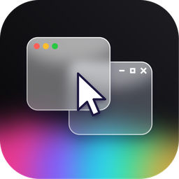
</p>

<h1 align="center"><a href="https://getduodesk.vercel.app">DuoDesk</a></h1>

<p align="center">
  <b>Todos os seus computadores e seu telefone funcionando em uma única mesa.</b><br>
  Telas, aplicativos, arquivos, área de transferência, câmeras, chamadas, mensagens, notificações, mouse e teclado compartilhados entre Mac, Windows, Linux e Android.<br>
  Gratuito e de código aberto. Sem conta, sem nuvem, sem necessidade de rede compartilhada.
</p>

<p align="center">
  <a href="#download"><b>⬇️ Baixar 2.5</b></a> ·
  <a href="https://getduodesk.vercel.app"><b>Site oficial</b></a> ·
  <a href="https://github.com/0xCodez/DuoDesk"><b>Código-fonte</b></a> ·
  <a href="#-novidades-na-versao-23"><b>Novidades</b></a> ·
  <a href="#-primeiros-passos"><b>Primeiros passos</b></a> ·
  <a href="#como-funciona"><b>Como funciona</b></a>
</p>

<p align="center">
  
  
  
  
  
  
  <a href="https://github.com/0xCodez/DuoDesk/releases"></a>
</p>

<p align="center">
  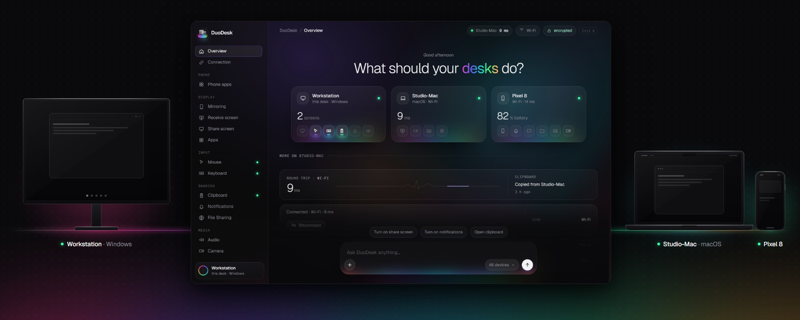
</p>

Seus dispositivos são ótimos em suas próprias tarefas, mas ruins em trabalhar juntos. O DuoDesk resolve isso.
Coloque um **Mac e um PC com Windows** lado a lado e use-os com um único mouse e teclado. Abra os
aplicativos do PC diretamente no Mac. Transforme um notebook antigo ou seu **tablet Android** em uma segunda tela. Atenda
às **chamadas e mensagens do seu telefone** a partir do computador, use a **câmera dele em videochamadas** e cole
em um dispositivo aquilo que copiou em outro.

- **Qualquer combinação.** Mac ↔ Windows, Mac ↔ Mac, PC ↔ PC, Linux ↔ qualquer um e Android ↔ qualquer computador. Ou, com o [DuoDesk Mesh](#-duodesk-mesh-todos-os-dispositivos-ao-mesmo-tempo), todos eles simultaneamente.
- **Em qualquer lugar.** No mesmo Wi-Fi, via cabo USB ou sem nenhuma rede compartilhada: via Bluetooth e uma conexão Wi-Fi direta própria entre eles.
- **Sem conta, sem nuvem.** Os dispositivos comunicam-se exclusivamente entre si por uma conexão criptografada.
- **Apenas o que você ativar.** Cada recurso inicia desativado e sequer é carregado na memória até você ativá-lo.

<table>
<tr>
<td width="33%" valign="top">

### 💻 [Computadores](#-computador-para-computador)
Um mouse e teclado · segunda tela · aplicativos do outro computador em janelas próprias · arquivos · área de transferência · **câmera** · áudio · terminal

</td>
<td width="33%" valign="top">

### 📱 [Telefones e tablets](#-telefone-e-tablet)
Chamadas · mensagens SMS · fotos · arquivos · **câmera** · **controle remoto e gamepad** · tela e aplicativos em janelas próprias · tablet como segunda tela

</td>
<td width="33%" valign="top">

### 📡 [Conexões](#-conexoes)
Mesmo Wi-Fi · cabo USB · **Bluetooth** · conexões diretas via **Wi-Fi Direct** e **ponto de acesso (hotspot)** criadas sob demanda · escolhidas e migradas automaticamente para você

</td>
</tr>
<tr>
<td width="33%" valign="top">

### 🚀 [Primeiros passos](#-primeiros-passos)
Baixe · abra em ambos · emparelhe uma vez com um código · ative o que desejar · [privacidade](#privacidade): sem contas, sem telemetria

</td>
<td width="33%" valign="top">

### 🐧 [Linux](#linux) e 🤖 [Android](#android-em-detalhes) em detalhes
X11 e Wayland · pastas compartilhadas via Samba · o aplicativo móvel página por página · [depuração sem fio](#depuracao-sem-fio), configurada uma única vez

</td>
<td width="33%" valign="top">

### 🛠 [Por baixo do capô](#como-funciona)
[Como funciona](#como-funciona) · [compilação e execução](#compilar-e-executar) no macOS, Windows, Linux, NixOS e Android · [GitHub Actions](#github-actions)

</td>
</tr>
</table>

<a name="download"></a>

## ⬇️ Baixar

<table>
<tr>
<td width="25%" align="center" valign="top">

**🍎 macOS**<br><sub>13 Ventura ou superior</sub>

<a href="https://github.com/0xCodez/DuoDesk/releases/download/v2.5.0/DuoDesk-2.5.0-arm64.dmg"></a>

</td>
<td width="25%" align="center" valign="top">

**🪟 Windows**<br><sub>10 e 11</sub>

<a href="https://github.com/0xCodez/DuoDesk/releases/download/v2.5.0/DuoDesk-Setup-2.5.0.exe"></a><br>
<a href="https://github.com/0xCodez/DuoDesk/releases/download/v2.5.0/DuoDesk-Setup-2.5.0-arm64.exe"></a>

</td>
<td width="25%" align="center" valign="top">

**🐧 Linux**<br><sub>X11 e Wayland, x86_64</sub>

<a href="https://github.com/0xCodez/DuoDesk/releases/download/v2.5.0/DuoDesk-2.5.0-amd64.deb"></a><br>
<a href="https://github.com/0xCodez/DuoDesk/releases/download/v2.5.0/DuoDesk-2.5.0-x86_64.AppImage"></a><br>
<a href="https://github.com/0xCodez/DuoDesk/releases"></a><br>
<sub>NixOS: <code>nix run github:0xCodez/DuoDesk</code> (<a href="#nixos--nix-flakes">saiba mais</a>)</sub>

</td>
<td width="25%" align="center" valign="top">

**🤖 Android**<br><sub>10 ou superior, telefones e tablets</sub>

<a href="https://github.com/0xCodez/DuoDesk/releases/download/v2.5.0/DuoDesk-2.5.0.apk"></a><br>
<a href="https://github.com/0xCodez/DuoDesk/releases/download/v2.5.0/DuoDesk-2.5.0-full.apk"></a><br>
<sub>O app completo adiciona notificações, mensagens SMS e Acessibilidade; o computador pode instalá-lo para você via depuração sem fio</sub>

</td>
</tr>
</table>

<a name="first-launch"></a>
<a name="primeira-execucao"></a>

<details>
<summary><b>⚠️ Primeira execução: os aplicativos não possuem assinatura de código</b> <sub>como autorizá-los no macOS, Windows e Android</sub></summary>

O DuoDesk é gratuito e não possui um Apple Developer ID pago nem certificado de assinatura de código do Windows. Por isso,
o macOS e o Windows não reconhecem quem o desenvolveu e solicitam confirmação uma vez antes de abri-lo. Todo o código-fonte está disponível aqui.

**🍎 macOS**

1. Arraste o DuoDesk para Aplicativos e abra-o. O macOS dirá que não pode verificar o DuoDesk: clique em **Concluído**
   (não em Mover para o Lixo).
2. Abra **Ajustes do Sistema › Privacidade e Segurança**, role até Segurança e clique em **Abrir Mesmo Assim**
   ao lado de "DuoDesk foi bloqueado". Digite sua senha e clique em **Abrir Mesmo Assim** novamente.

Você só precisa fazer isso uma vez; as atualizações posteriores abrirão normalmente. Se o macOS indicar que o DuoDesk **está danificado e não pode ser
aberto**, isso não é verdade: execute o comando abaixo no Terminal e abra-o novamente:

```sh
xattr -dr com.apple.quarantine /Applications/DuoDesk.app
```

**🪟 Windows**

1. Se o navegador alertar que o arquivo não é comumente baixado, escolha **Manter** (no Edge: **⋯ ›
   Manter › Mostrar mais › Manter assim mesmo**).
2. Quando o instalador exibir **O Windows protegeu o seu computador** (SmartScreen), clique em **Mais informações** e, em seguida,
   em **Executar assim mesmo**.

No Windows 11 com o **Controle de Aplicativos Inteligente (Smart App Control)** ativado, aplicativos não assinados são bloqueados sem o botão Executar assim mesmo.
A única forma de contornar isso é desativando-o (Segurança do Windows › Controle de aplicativos e do navegador › Configurações do Controle de Aplicativos Inteligente),
e em muitas versões do Windows 11 ele não pode ser reativado sem reinstalar o Windows.

**🤖 Android**

1. Abra o arquivo .apk baixado. O Android solicitará permissão para seu navegador ou app Arquivos **instalar aplicativos desconhecidos**: toque em **Configurações**, ative **Permitir desta fonte**, volte e toque em **Instalar**.
2. Se o Play Protect alertar sobre desenvolvedor não reconhecido, toque em **Mais detalhes › Instalar assim mesmo**.

O **aplicativo completo** (notificações, SMS e Acessibilidade) é instalado mais facilmente pelo computador via
[depuração sem fio](#depuracao-sem-fio) (página Telefone › Notificações do telefone): dessa forma, o Android
permite que você ative essas permissões. Se instalado manualmente, o Play Protect pode bloqueá-lo, e o Android 13 e superiores desativam
o acesso a notificações e Acessibilidade como uma **configuração restrita**: abra **Configurações › Aplicativos ›
DuoDesk**, toque em **⋮ › Permitir configurações restritas** e, em seguida, ative-as.

</details>

<p align="center"><sub>Todos os arquivos e versões anteriores estão na <a href="https://github.com/0xCodez/DuoDesk/releases">página de lançamentos (releases)</a>.</sub></p>

---

<a name="novidades"></a>
<a name="-new-in-23"></a>
<a name="-novidades-na-versao-23"></a>

# ✨ Novidades na versão 2.3

<p align="center">
  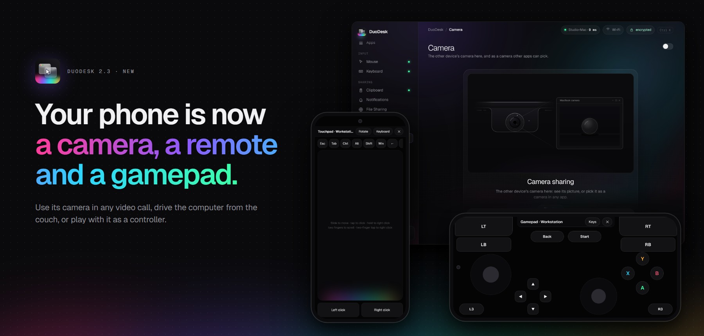
</p>

Seu telefone agora é **uma câmera, um controle remoto e um gamepad**. Use a câmera dele em qualquer videochamada, controle seu
computador direto do sofá ou jogue usando-o como controle. Copie fotos e capturas de tela entre todas
as telas e trave o ponteiro em um único computador com uma tecla.

| | O que há de novo | |
|---|---|---|
| 📷 | **Câmera.** A câmera do telefone ou do outro computador em uma janela ou como webcam para Zoom, Teams e Meet | [Saiba mais](#-camera-do-telefone) |
| 🎮 | **Controle remoto e gamepad.** Um touchpad e teclado para o computador, e um controle que ele reconhece como real | [Saiba mais](#-controle-remoto-e-gamepad) |
| 🖼 | **Imagens na área de transferência.** Copie uma captura de tela no PC e cole no Mac ou no telefone | [Saiba mais](#-area-de-transferencia-compartilhada) |
| 🔒 | **Bloqueio de cursor.** Scroll Lock mantém o ponteiro fixo no computador atual | [Saiba mais](#-um-mouse-e-teclado) |
| 🎵 | **Controles de mídia.** Veja o que está tocando no telefone, com reproduzir, pausar e avançar no computador | [Saiba mais](#-controles-de-midia-e-som-do-telefone) |
| 🪶 | **Mais leve.** Cada recurso desligado até você ativá-lo, e cerca de metade do consumo de memória na bandeja | [Saiba mais](#-tambem-novo-na-versao-23) |

<a name="-tambem-novo-na-versao-23"></a>

## ➕ Também novo na versão 2.3

- **Cada recurso vem desativado em uma instalação limpa** e nada é carregado até que você o ative. Atualizações mantêm suas configurações.
- **Ao fechar para a bandeja ou barra de menus, a janela também é liberada:** no Windows, o consumo caiu de cerca de 240 MB para cerca de 125 MB.
- **<kbd>Ctrl+Alt+V</kbd> / <kbd>⌃⌥V</kbd> cola arquivos direto no aplicativo em primeiro plano**, seja um chat ou e-mail, e não apenas em pastas.
- **Escolha onde os arquivos recebidos são salvos** (Geral › Arquivos recebidos) no Windows e Linux, exatamente como no Mac.
- **Janelas do telefone:** Enter envia mensagens no WhatsApp, Instagram e Telegram; no Windows, os controles ficam em um painel lateral, com botão de girar e captura de tela.
- **A própria tela do telefone no computador**, iniciada diretamente da página Tela no telefone.
- **Modo touchpad** para controlar a tela do computador no telefone: deslize para mover o ponteiro, toque para clicar.
- **Bateria do telefone:** um telefone bloqueado não acende mais a tela sozinho, e a descoberta de dispositivos não o mantém acordado.
- **A depuração sem fio pode desligar-se automaticamente** quando o computador se desconecta (Geral › Permitir no telefone).
- **O ponteiro no telefone** é exibido sobre a barra de notificações e também nas telas de Configurações.
- **Bluetooth e Wi-Fi Direct mais estáveis com telefones**, e o adb do Android Studio ou do scrcpy é priorizado antes do adb embutido, evitando conflitos entre eles.
- **Downloads específicos para Macs com Intel**, e compilações preparadas para assinatura e notarização com Developer ID.

Agradecimentos a todos que enviaram pull requests para esta versão: consulte [Agradecimentos](#agradecimentos).

<sub>Versões anteriores: a 2.2 trouxe o [DuoDesk Mesh](#-duodesk-mesh-todos-os-dispositivos-ao-mesmo-tempo), a 2.1 trouxe
[Bluetooth e Wi-Fi Direct](#-conexoes) e [chamadas, mensagens, fotos e arquivos](#-chamadas-e-mensagens) do telefone.
As notas de todas as versões estão disponíveis na [página de lançamentos](https://github.com/0xCodez/DuoDesk/releases).</sub>

---

<a name="computador-para-computador"></a>
<a name="-computer-to-computer"></a>
<a name="-computador-para-computador"></a>

# 💻 Computador para computador

<p align="center">
  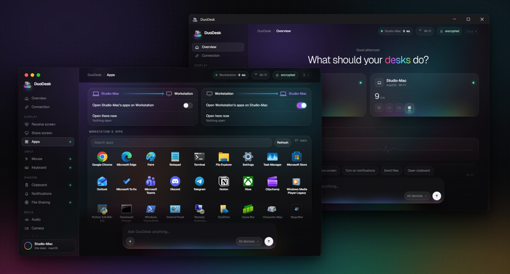
</p>

O mesmo aplicativo em todas as plataformas, fazendo com que um Mac e um PC se emparelhem exatamente como dois Macs.

<a name="-um-mouse-e-teclado"></a>

## 🖱 Um mouse e teclado

Mova o ponteiro além da borda da tela e **continue trabalhando no outro computador**, como se
fossem um só. Seu teclado acompanha o ponteiro. Gestos de trackpad (troca de mesas/Spaces, pinça para zoom,
mostrar mesa) são repassados, e um toque duplo na tecla de atalho traz tudo de volta. Configure em qual lado
o outro computador está posicionado, a resistência de borda e a velocidade do ponteiro.

O **Bloqueio de cursor** (novo na versão 2.3) mantém o ponteiro preso no computador atual, mesmo naquele onde o mouse
não está fisicamente conectado: pressione **Scroll Lock** (F14 no Mac), ou use a aba Cursor ou a bandeja / barra de menus.

## 🖥 Tela estendida e tela remota

Estenda a área de trabalho do seu Mac para um PC ou outro Mac com uma **tela virtual real**, ou espelhe-a. Ou traga
a tela do outro computador para dentro de uma janela e controle-o a partir dali. Transmissão H.264 de baixa latência com
modos de reprodução *Mais Rápido* e *Suave*, além de geração opcional de quadros (*frame generation*).

<p align="center">
  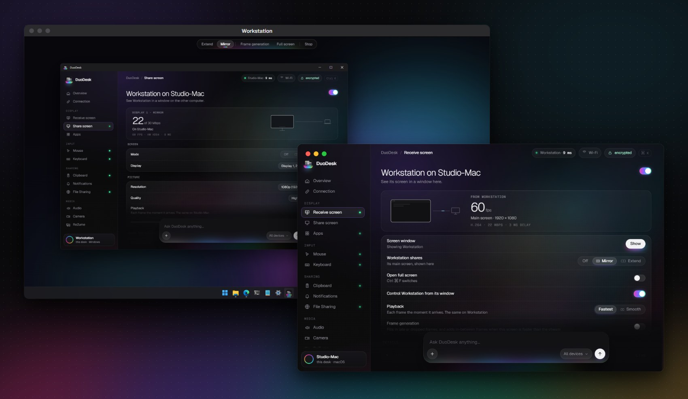
</p>

## 🪟 Os aplicativos do outro computador, em janelas próprias

Abra um **aplicativo do Windows no seu Mac** (ou um app do Mac no seu PC) e ele ganha **uma janela própria**,
com seu próprio ícone no Dock ou fixado no menu Iniciar. Nada de área de trabalho remota inteira: apenas o aplicativo que você precisa, lado a lado com os seus.

<p align="center">
  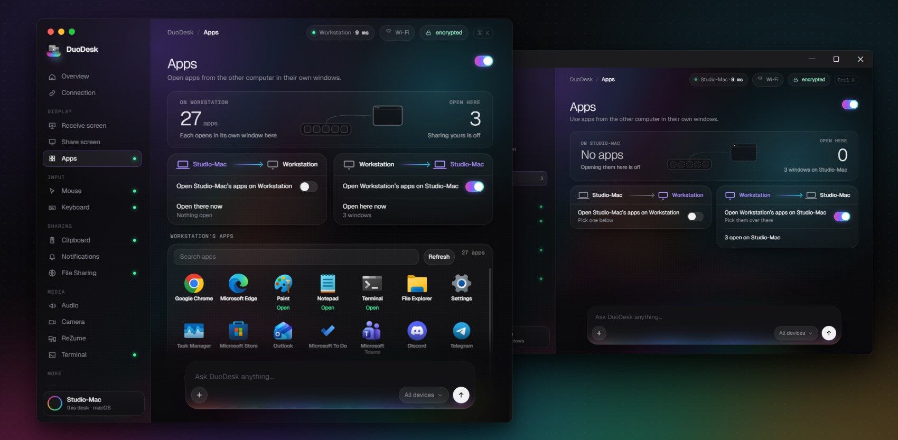
</p>

## 📷 Compartilhamento de câmera

Exiba a câmera do outro computador em uma janela ou envie-a para uma **webcam que qualquer aplicativo pode selecionar**:
**DuoDesk Camera** no Zoom, Teams, Meet ou navegador. O computador só compartilha sua câmera quando você
ativa a opção *Permitir que … veja esta câmera* nele, e um aviso popup informa quem está assistindo. O mesmo funciona com
a [câmera do telefone](#-camera-do-telefone).

A câmera virtual é instalada na primeira vez que você a ativa: uma câmera no Windows 11 (uma confirmação de administrador),
v4l2loopback no Linux (uma confirmação de senha) e, no Mac, ela integra-se à **OBS Virtual Camera** (ou à extensão de câmera proprietária do DuoDesk, em versões assinadas para isso).

## 📁 Arquivos, pastas compartilhadas e terminal

**Arraste arquivos pela borda da tela** e solte-os em qualquer lugar, ou copie com <kbd>⌃⌥C</kbd> e
cole com <kbd>⌃⌥V</kbd> (<kbd>Ctrl+Alt+C/V</kbd> no Windows e Linux), dentro de uma pasta ou diretamente
no app em primeiro plano. Envie pelo menu Compartilhar do macOS ou pelo *Enviar para* do Explorer, ou **compartilhe uma pasta**
que aparece como unidade de rede no outro dispositivo. Arquivos em trânsito mostram o **progresso em tempo real**.
Precisa de um terminal? O comando `ssh duodesk` abre uma sessão no outro computador, sem necessidade de senhas.

<p align="center">
  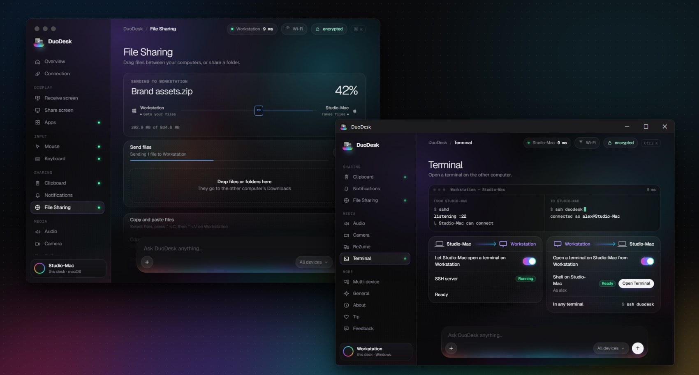
</p>

<a name="-area-de-transferencia-compartilhada"></a>

## 📋 Área de transferência compartilhada

Copie em um computador e cole no outro, instantaneamente ou ao alternar entre eles. **Imagens** também são suportadas
(novo na versão 2.3), de até 10 MB: tire uma captura de tela com <kbd>Win+Shift+S</kbd> no PC e cole no Mac.
Itens de gerenciadores de senhas são ignorados, e uma lista de Recentes mantém os últimos itens copiados,
com pré-visualização para imagens.

<p align="center">
  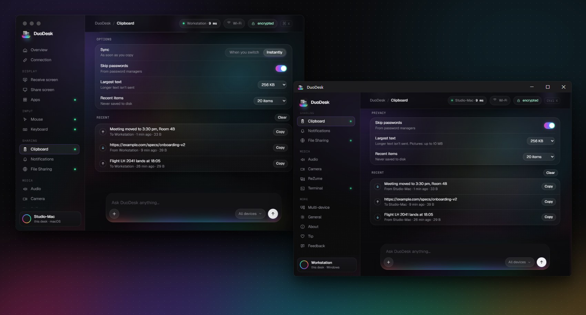
</p>

## 🔔 Notificações, áudio e Wake-on-LAN

Veja as notificações de um computador no outro como notificações nativas e ouça o áudio de um computador
no outro. Acorde um computador em suspensão com Wake-on-LAN; cada opção que você altera é sincronizada
entre ambos os lados e lembrada para o par.

## 🔀 Mais de dois dispositivos

Emparelhe quantos computadores e telefones quiser. O botão **Alternar** migra a sessão para outro dispositivo emparelhado
próximo, **Assumir controle** toma posse de um que esteja em uso por outro dispositivo e **Desconectar** encerra a conexão.
Tudo acessível pela Visão Geral, barra de menus ou bandeja do sistema.

<a name="-duodesk-mesh-todos-os-dispositivos-ao-mesmo-tempo"></a>
<a name="-duodesk-mesh-every-device-at-once"></a>

## 🕸 DuoDesk Mesh: todos os dispositivos ao mesmo tempo

<p align="center">
  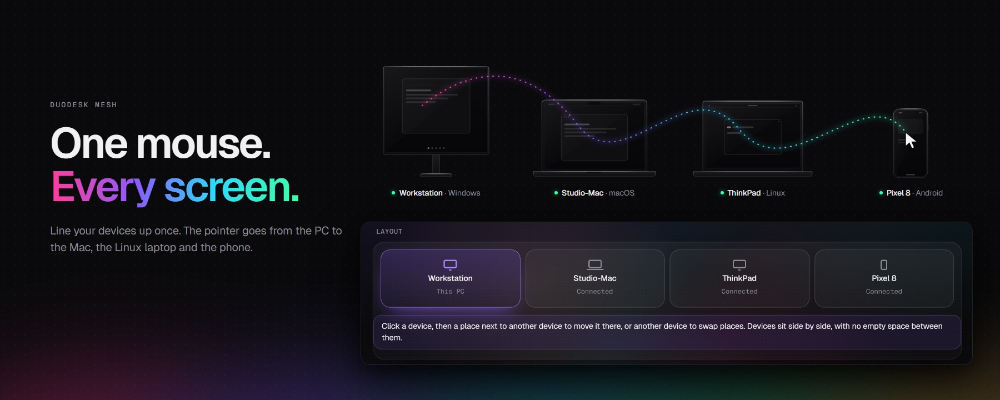
</p>

Seu notebook, seu desktop, o computador Linux no canto da sala e seu telefone, **todos conectados simultaneamente**,
comunicando-se diretamente uns com os outros, sem nenhum servidor intermediário.

- **Um mouse, todas as telas.** Organize seus dispositivos no mapa uma vez e o ponteiro transita do PC para o Mac, para o notebook Linux e para o telefone.
- **Uma única área de transferência.** Copie em qualquer um e cole em qualquer outro. O item copiado mais recente prevalece.
- **Um grupo unificado de notificações.** Seu telefone vibra e todos os computadores exibem a notificação.
- **Emparelhe uma vez, conecte com todos.** Um novo dispositivo emparelhado com um computador conhece os demais de forma automática.

O Mesh funciona no Windows, Mac e Linux: ative-o na aba **Multidispositivo** e desative-o a qualquer
momento mantendo tudo como você deixou. Vai conectar apenas dois dispositivos? Você não precisará dele. Em
desenvolvimento para o Mesh: imagens na área de transferência e arrastar arquivos para mais de um dispositivo ao mesmo
tempo; o telefone conecta-se a um computador por vez, e o Linux conecta-se apenas pela mesma rede Wi-Fi.

---

<a name="telefone-e-tablet"></a>
<a name="-phone-and-tablet"></a>
<a name="-telefone-e-tablet"></a>

# 📱 Telefone e tablet

A maioria das integrações com telefones limita-se a notificações e envio simples de arquivos. No DuoDesk, seu telefone ou tablet Android
é um **dispositivo equivalente (peer completo)**: ele é emparelhado como um computador e recebe os mesmos recursos, além de chamadas, mensagens SMS, fotos,
arquivos e câmera.

<a name="-chamadas-e-mensagens"></a>

## 📞 Chamadas e mensagens

Atenda, recuse e faça chamadas telefônicas diretamente pelo computador. Quando o telefone toca, uma pequena janela exibe
quem está ligando com os botões **Atender** e **Recusar**. Com Bluetooth, o computador torna-se **o headset do
telefone**, permitindo falar e ouvir diretamente por ele. A página **Chamadas** inclui teclado numérico, contatos
e histórico de chamadas.

Leia e responda às suas mensagens SMS na página **Mensagens**: todas as conversas, incluindo fotos, com contador de não lidas
na barra lateral.

<p align="center">
  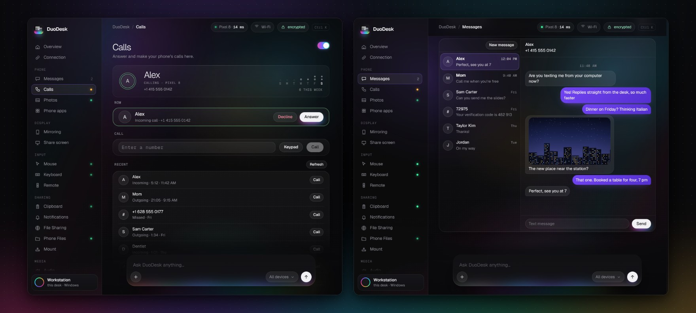
</p>

## 🖼 Fotos e arquivos do telefone

Navegue pelas **fotos e vídeos** do telefone na página **Fotos**, abra qualquer mídia ampliada e salve uma ou várias
no computador. A página **Arquivos do telefone** permite navegar por todo o armazenamento: salvar, enviar, renomear, excluir
ou simplesmente soltar arquivos na janela. **Pastas compartilhadas funcionam em ambas as direções:** uma pasta compartilhada pelo telefone abre no
Finder, no Explorer ou no gerenciador de arquivos do Linux, e uma pasta compartilhada pelo computador surge no app
Arquivos do telefone.

<p align="center">
  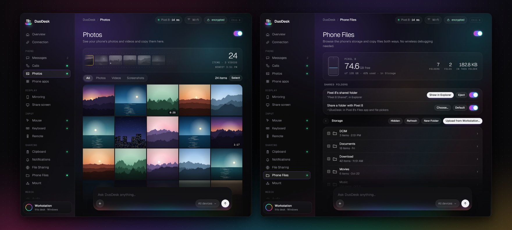
</p>

<a name="-camera-do-telefone"></a>
<a name="-phone-camera"></a>

## 📷 Câmera do telefone

A **câmera traseira ou frontal** do telefone, em uma janela no computador ou como webcam **DuoDesk Camera**
em qualquer videochamada. Alterne entre as câmeras e gire a imagem a partir da aba Câmera, ou inicie
diretamente da própria página Câmera no telefone.

<a name="-controle-remoto-e-gamepad"></a>
<a name="-remote-and-gamepad"></a>

## 🎮 Controle remoto e gamepad

<p align="center">
  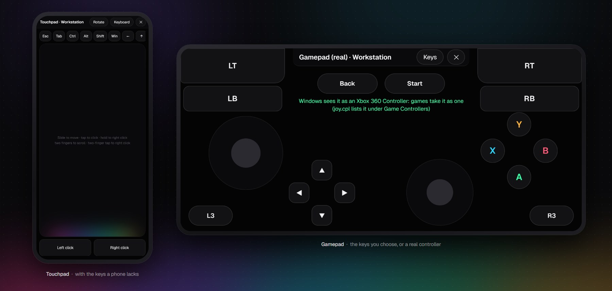
</p>

A página **Controle remoto** do telefone o transforma em um controle para o computador, ideal para o sofá ou apresentações:

- **Touchpad e teclado.** Deslize para mover, toque para clicar, dois dedos para rolar, com teclas que teclados
  de celular não possuem (Esc, Tab, Ctrl, Alt, setas, mídia e volume). Gire o telefone para o modo paisagem.
- **Gamepad,** com layout de controle Xbox. Seus botões acionam as teclas que você escolher, ou ative
  **Gamepad real** para que o computador reconheça um controle físico: um controle Xbox 360 no Windows
  ou um gamepad no Linux.
- **Um gamepad Bluetooth para qualquer computador**, inclusive Mac, sem DuoDesk instalado e sem drivers adicionais:
  basta emparelhar o telefone nas configurações Bluetooth do computador uma única vez.

Ative o **Controle remoto** no computador para permitir que o telefone o controle.

<a name="-controles-de-midia-e-som-do-telefone"></a>
<a name="-media-controls-and-phone-sound"></a>

## 🎵 Controles de mídia e som do telefone

O que está tocando no telefone aparece em seu cartão na Visão Geral, com a capa do álbum, botões **Anterior,
Reproduzir/Pausar, Próximo** e uma barra de progresso. No Windows e Linux, a opção **Tocar som do telefone aqui** faz do
computador a caixa de som Bluetooth do telefone.

## 📲 Tela do telefone e aplicativos no computador

Visualize a tela do seu telefone em uma janela e controle-a com mouse, trackpad e teclado. Melhor
ainda: abra **aplicativos Android individuais em janelas próprias**, lado a lado com seus apps desktop.
Fixe-os no Dock ou no menu Iniciar e utilize-os como qualquer outro programa. No WhatsApp, Instagram e
Telegram, a tecla Enter envia mensagens.

<p align="center">
  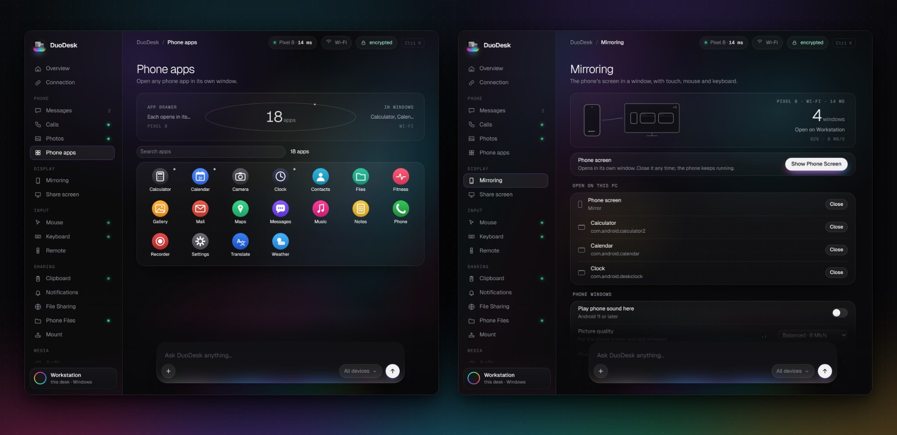
</p>

## 🖥 Tablet como segunda tela

Transforme um tablet ou telefone em um **monitor adicional**. Escolha **Estender** para mais espaço na área de trabalho ou **Espelhar**
para exibir o conteúdo da sua tela. Use o toque como mouse ou ative o modo touchpad.

<p align="center">
  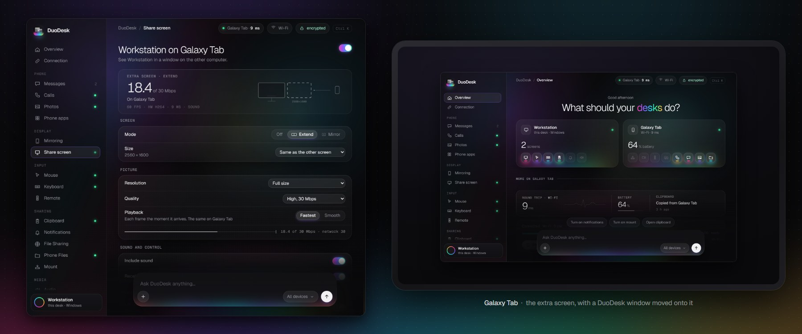
</p>

## 📤 Arquivos, área de transferência, notificações, mouse e teclado

- **Arquivos.** Toque em *Enviar para computador* ou *Copiar para computador* pelo menu de compartilhamento de qualquer app Android; do
  computador, use o menu Compartilhar, *Enviar para*, arraste pela borda da tela ou pressione <kbd>⌃⌥C</kbd> / <kbd>Ctrl+Alt+C</kbd>.
- **Área de transferência.** Textos e imagens em ambas as direções, incluindo capturas de tela do telefone, com um atalho nas Configurações Rápidas para envio imediato.
- **Notificações.** Notificações do telefone no computador de forma nativa e vice-versa. Oculte o conteúdo das mensagens ou silencie aplicativos específicos.
- **Mouse e teclado.** Mova o ponteiro além da borda da tela e ele **continua direto na tela do telefone**;
  digite com seu teclado físico em qualquer aplicativo Android.

<p align="center">
  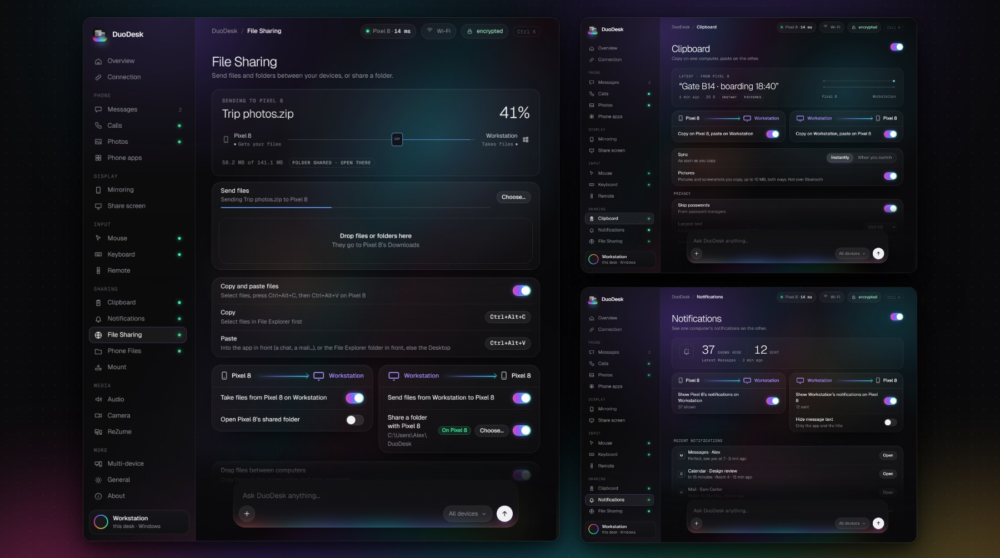
</p>

## 📱 O aplicativo Android

O aplicativo Android adapta-se ao dispositivo: abas na parte inferior no telefone, barra lateral completa em tablets.
Cada página identifica o computador conectado e mostra o que está sendo compartilhado em cada direção.

<p align="center">
  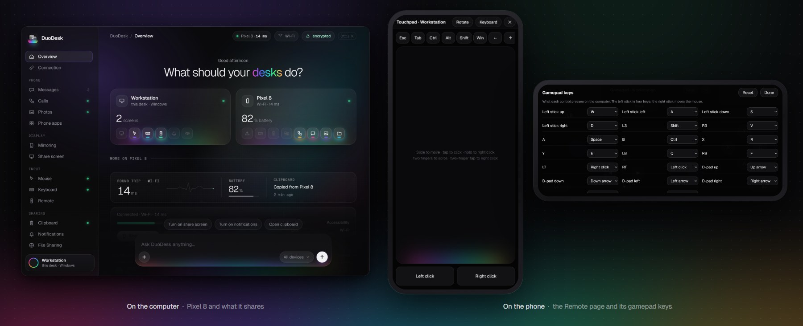
</p>

---

<a name="conexoes"></a>
<a name="-connections"></a>
<a name="-conexoes"></a>

# 📡 Conexões

<p align="center">
  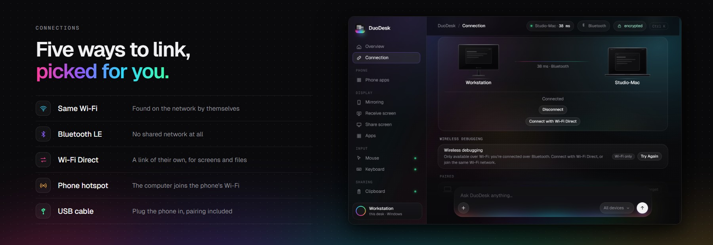
</p>

Você nunca precisa escolher manualmente. O DuoDesk utiliza a mesma rede quando disponível, transfere o telefone para
o **cabo USB** quando você o conecta e recorre ao **Bluetooth** caso o Wi-Fi caia: em viagens de trem
ou em cafeterias cujo Wi-Fi público bloqueia a comunicação entre dispositivos. O tipo de conexão e sua latência são sempre exibidos
no topo do aplicativo (*38 ms · Bluetooth*).

O Bluetooth é excelente para a sessão, mas lento para transmissão de tela ou arquivos grandes. Assim, ao iniciar uma dessas ações,
o DuoDesk **estabelece uma conexão Wi-Fi direta** entre os dois dispositivos pelo tempo que for necessário,
retornando ao Bluetooth em seguida. Clique em **Conectar com Wi-Fi Direct** para mantê-la ativa, ou permita que o computador se conecte ao
**ponto de acesso (hotspot)** do telefone.

| | Mesmo Wi-Fi | Cabo USB | Bluetooth | + Wi-Fi Direct ou hotspot |
|---|:-:|:-:|:-:|:-:|
| Sessão, texto da área de transferência, notificações | ✅ | ✅ | ✅ | ✅ |
| Mouse e teclado, controle remoto | ✅ | ✅ | ✅ | ✅ |
| Chamadas e mensagens SMS | ✅ | ✅ | ✅ | ✅ |
| Telas, aplicativos, câmeras, arquivos, fotos, imagens da área de transferência | ✅ | ✅ | migra para Wi-Fi Direct | ✅ |
| Terminal entre computadores (`ssh duodesk`) | ✅ | — | via Wi-Fi Direct | ✅ |

Você escolhe quem pode se conectar via Bluetooth: **Bluetooth com telefones** (ativo por padrão) e **Bluetooth com
computadores** (desativado até você permitir), na Visão Geral e em Geral.

---

<a name="primeiros-passos"></a>
<a name="-get-started"></a>
<a name="-primeiros-passos"></a>

# 🚀 Primeiros passos

<p align="center">
  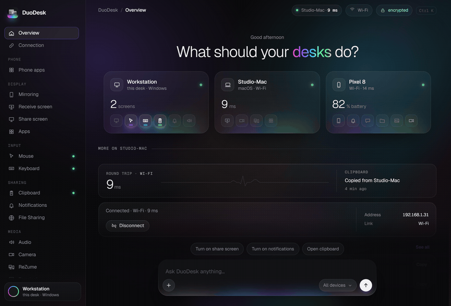
</p>

1. **Baixe** o DuoDesk para cada computador e para seu telefone ([acima](#download), ou nas [versões/releases](https://github.com/0xCodez/DuoDesk/releases)).
2. **Abra nos dois dispositivos.** Eles se encontrarão na mesma rede, via Bluetooth ou via cabo USB no caso de telefones.
3. **Emparelhe uma vez** confirmando o código exibido (no cabo USB, basta clicar em Permitir). A partir daí, conectarão automaticamente.
4. **Ative o que desejar.** Cada recurso tem uma aba própria com interruptor e explica o que faz até ser ligado.

Para visualização da tela do telefone, aplicativos e câmera em janelas, o DuoDesk orienta você a ativar a depuração sem fio do Android uma única vez ([detalhes](#depuracao-sem-fio)). Arquivos, área de transferência, chamadas e fotos funcionam sem ela. As notificações do telefone, SMS, controles de mídia e controle de mouse e teclado por Acessibilidade vêm com o app completo, que o próprio computador instala via depuração sem fio.

| Par | Recursos disponíveis |
|---|---|
| Mac ↔ PC Windows, Mac ↔ Mac, PC ↔ PC | Todos os recursos de computador |
| Linux ↔ Mac, PC ou Linux | Todos os recursos de computador ([algumas diferenças](#linux)) |
| Android ↔ Mac, Windows ou Linux | Todos os recursos de telefone e tablet (Gamepad real no Windows e Linux) |
| Todos simultaneamente | [DuoDesk Mesh](#-duodesk-mesh-todos-os-dispositivos-ao-mesmo-tempo) |

<a name="privacidade"></a>
<a name="privacy"></a>

## Privacidade

O DuoDesk comunica-se exclusivamente com dispositivos que você autorizou e emparelhou, diretamente pela sua rede local, Bluetooth,
link direto Wi-Fi ou cabo. Não existem contas de usuário, telemetria ou servidores de retransmissão em nuvem. Suas chamadas,
mensagens SMS, fotos e imagens de câmera trafegam diretamente do telefone para o computador e para nenhum outro lugar. A única
requisição à internet é a verificação de atualizações contra as versões públicas do GitHub, que pode ser desativada.

<br>

---

Todo o conteúdo abaixo destina-se aos interessados em detalhes técnicos e em compilar o DuoDesk por conta própria.

<a name="linux"></a>
<details>
<summary><h2>🐧 Linux</h2> <sub>X11 e Wayland, pastas compartilhadas, Estender, câmera virtual e gamepad</sub></summary>

No Linux, o DuoDesk roda tanto no X11 quanto no Wayland. No Wayland, o mouse e o teclado operam
via evdev e uinput (a tela de Configuração concede acesso uma única vez), e as telas são capturadas pelo
portal do desktop. Alguns detalhes funcionam de modo ligeiramente diferente:

- **Pasta compartilhada.** O compartilhamento utiliza Samba. Na primeira vez, uma solicitação de senha instala o pacote caso
  esteja ausente e cria uma conta exclusiva de rede. A pasta do outro computador é conectada com GVFS
  e surge na barra lateral do gerenciador de arquivos.
- **Copiar e colar arquivos.** <kbd>Ctrl+Alt+C</kbd> copia os itens selecionados no gerenciador de arquivos em
  primeiro plano (ou arquivos já copiados), e <kbd>Ctrl+Alt+V</kbd> cola na janela do gerenciador de arquivos em
  primeiro plano (caso contrário, na pasta Downloads). Clique com botão direito › *Enviar para* funciona no Nautilus, Nemo, Caja,
  Dolphin e Thunar.
- **Arrastar arquivos pela borda.** Arquivos arrastados a partir do outro computador são soltos na
  pasta sob o cursor ou na área de trabalho. No Wayland, eles vão para a janela do gerenciador de arquivos em
  primeiro plano. Arrastar arquivos para fora do Linux requer uma sessão Xorg.
- **Estender.** No GNOME (Wayland), utiliza o monitor virtual nativo do Mutter; selecione "Virtual remote
  monitor" quando o sistema perguntar qual tela compartilhar. No X11, ativa uma saída sobressalente do
  driver de vídeo (indisponível no driver proprietário da NVIDIA). Isso requer um pequeno utilitário auxiliar, instalado pelo
  pacote .deb; no AppImage, Compartilhar tela › *Monitor virtual TwinDesk* › Instalar configura-o
  uma vez, solicitando sua senha.
- **Aplicativos.** Abrir aplicativos deste computador no outro requer uma sessão Xorg.
- **Câmera virtual e gamepad.** A DuoDesk Camera é um dispositivo v4l2loopback, e o Gamepad real é um
  dispositivo uinput ("TwinDesk Gamepad"); cada um solicita sua senha de administrador uma vez, na primeira ativação.
- **Bluetooth e Wi-Fi Direct.** O Bluetooth LE opera via BlueZ, e as conexões Wi-Fi diretas via
  NetworkManager, hospedadas ao lado do Wi-Fi do computador quando a placa de rede permite (grupos de 2.4 GHz
  para conexão com telefone).
- **Telefone Android.** Tudo descrito em [Android](#android-em-detalhes) funciona no Linux também: tela e
  apps em janelas, mouse e teclado na borda, arquivos, área de transferência, notificações e
  áudio. O pacote traz o adb incluso; a correção de firewall na tela de Configuração libera o mDNS (5353/udp) para que a
  depuração sem fio do telefone seja localizada.

</details>

<a name="android-in-detail"></a>
<a name="android-em-detalhes"></a>
<details>
<summary><h2>🤖 Android em detalhes</h2> <sub>o aplicativo móvel página por página e depuração sem fio</sub></summary>

Instale o DuoDesk no telefone, abra-o ao lado do DuoDesk no computador e emparelhe a partir de Visão Geral › Próximos. O telefone requer Android 10, e Android 11 para todos os recursos que dependem de depuração sem fio.

### O aplicativo para telefone

O app é estruturado como o dos computadores (uma barra lateral em tablets, abas na parte inferior em telefones), e
cada página identifica o computador ao qual está conectado:

| Página | O que faz |
|---|---|
| **Visão Geral** | O computador conectado, Conectar e Desconectar, computadores próximos para emparelhar e o cartão de depuração sem fio até a configuração ser concluída |
| **Tela** | Use o telefone como monitor para o computador: Espelhar ou Estender a área de trabalho para ele. O toque funciona como mouse (toque para clicar, segure para botão direito, arraste para selecionar ou mover janelas, dois dedos para rolar), com áudio do computador e reprodução Suave |
| **Cursor** | O mouse do computador no telefone através da borda da tela, velocidade do ponteiro aqui, rolagem invertida, clique direito e clique com o botão do meio |
| **Teclado** | O teclado do computador digita no telefone tecla por tecla, garantindo funcionamento de qualquer layout enquanto o teclado virtual fica oculto. Um teclado no telefone digita no computador |
| **Controle remoto** | O telefone como touchpad e teclado do computador, ou como gamepad: teclas personalizadas, controle físico real (Windows, Linux) ou gamepad Bluetooth para qualquer computador |
| **Câmera** | A câmera traseira ou frontal do telefone no computador e se a câmera virtual a recebe |
| **Área de transferência** | Copie em um, cole no outro, cada direção com seu interruptor, instantaneamente ou sob demanda |
| **Notificações** | As notificações do telefone no computador, com opção de ocultar o texto da mensagem, e as do computador no telefone |
| **Arquivos** | Envie arquivos, copie para colar no computador e veja onde os arquivos recebidos são salvos |
| **Som** | O áudio do telefone no computador e o áudio do computador no telefone |
| **Geral** | O nome do telefone, execução em segundo plano e as permissões utilizadas pelo DuoDesk, cada uma com seu interruptor |
| **Sobre** | Código-fonte, versões, licença e informações sobre o tráfego via depuração sem fio e rede |

E fora do aplicativo:

- **Menu de compartilhamento:** *Enviar para computador* e *Copiar para computador* disponíveis no menu Compartilhar de qualquer aplicativo.
- **Atalhos nas Configurações Rápidas:** *Enviar área de transferência* e *Depuração sem fio*.
- **Atalhos na tela inicial:** a tela do computador e ativação da depuração sem fio em um único toque.
- **Notificação permanente:** exibe o que está conectado, com botão Sair.
- **Copiado no computador:** arquivos copiados com <kbd>⌃⌥C</kbd> / <kbd>Ctrl+Alt+C</kbd> chegam como
  notificação com as opções Copiar (para colar em qualquer app) e Salvar.
- **O computador pode instalar o app completo** via depuração sem fio (página Telefone › Notificações
  do telefone): o Play Protect bloqueia aplicativos baixados que acessem notificações, SMS ou usem
  o serviço de Acessibilidade. Por isso, o download padrão omite essas permissões e o computador as adiciona. Configurações e emparelhamentos são mantidos.

<a name="wireless-debugging"></a>
<a name="depuracao-sem-fio"></a>

### Depuração sem fio

Arquivos, área de transferência e notificações funcionam de imediato. A tela do telefone, aplicativos em janelas,
toque, controle de mouse e teclado no telefone e áudio utilizam **depuração sem fio**, que
o DuoDesk emparelha uma única vez:

<p align="center">
  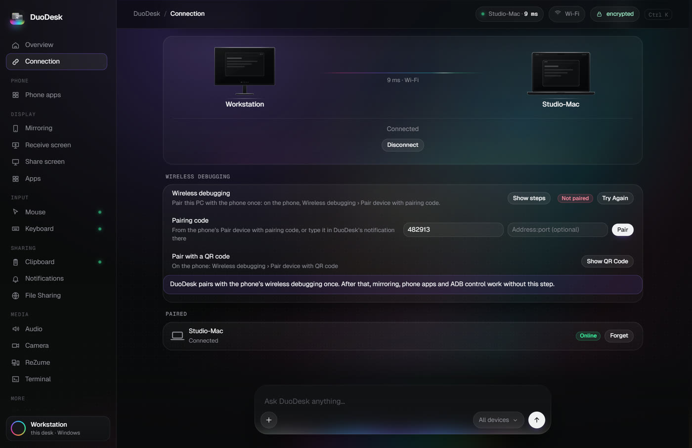
</p>

- Até ser emparelhado, um cartão abaixo dos computadores conectados em Conexão (no computador e no
  telefone) orienta o processo. Abra *Opções do desenvolvedor › Depuração sem fio › Emparelhar dispositivo com
  código de pareamento* no telefone e digite o código de 6 dígitos no computador ou na notificação do
  DuoDesk no telefone (o diálogo de Configurações permanece aberto). O telefone envia o código para o computador
  conectado: Mac, PC ou Linux.
- Depois disso, o DuoDesk ativa a depuração sem fio automaticamente quando necessário, acompanha a
  nova porta sempre que ela reiniciar e impede que o emparelhamento expire (o Android normalmente esquece
  computadores não utilizados após 7 dias). Telefones que desativam a função a cada troca de Wi-Fi ou bloqueio de tela
  (MIUI, HyperOS) têm a depuração reativada assim que desbloqueados, ou exibem uma solicitação de confirmação.
  A depuração sem fio só funciona enquanto a **Depuração USB** também estiver ativa, por isso o DuoDesk ativa ambas.
- Dispositivos **Xiaomi, Redmi e POCO** também precisam ativar *Opções do desenvolvedor › Depuração USB (Configurações de segurança)* para
  suporte a toque, mouse e teclado (exige login em Conta Mi). Sem isso, a imagem é transmitida mas a entrada de dados é
  recusada; a página Telefone no computador informará "Toque bloqueado" até que a opção seja ativada.
- **No Mac, o telefone no Finder.** Ative na aba Montar e clique em Montar: o telefone aparece
  em Locais como qualquer servidor de rede. Até esse momento, o DuoDesk nunca lê os arquivos do telefone. A conexão
  ocorre via cabo quando a depuração USB é autorizada, ou via depuração sem fio. Arquivos `.DS_Store` e `._` do Finder nunca são gravados no telefone.

</details>

<a name="how-it-works"></a>
<a name="como-funciona"></a>
<details>
<summary><h2>⚙️ Como funciona</h2> <sub>o aplicativo Electron, os utilitários nativos e a conexão entre dispositivos</sub></summary>

<p align="center">
  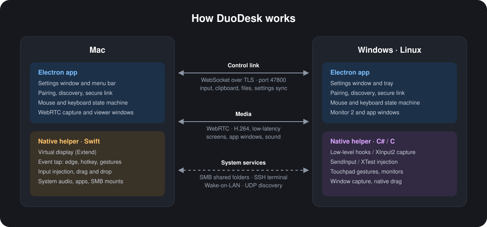
</p>

Cada computador executa um **aplicativo Electron**, responsável pela interface, emparelhamento, conexão e máquinas
de estado. Ao lado dele, roda um pequeno **utilitário auxiliar nativo** para tudo o que o sistema operacional restringe:
captura e injeção de eventos de entrada, telas virtuais, gestos, captura de janelas e arrastar e soltar nativo.

| Pasta | Conteúdo |
|---|---|
| `mac/` | Aplicativo macOS (Electron) |
| `mac-helper/` | Utilitário macOS (Swift): tela virtual, event tap, injeção de entrada, áudio, aplicativos, SMB |
| `windows/` | Aplicativo Windows (Electron) e instalador |
| `windows-helper/` | Utilitário Windows (C#): hooks, SendInput, Raw Input para touchpad, captura de janelas, arrastar nativo |
| `linux/` | Aplicativo Linux (Electron) |
| `linux-helper/` | Utilitário Linux (C): XInput2 / XTest no X11, evdev / uinput no Wayland, XRandR, lista de janelas, borda XDND |
| `android/` | Aplicativo Android (Kotlin, Jetpack Compose); os computadores controlam o telefone via adb e servidor do [scrcpy](https://github.com/Genymobile/scrcpy) |
| `shared/` | Compartilhado por todos os apps: protocolo de comunicação, canal Bluetooth e links Wi-Fi Direct, hub do telefone (Chamadas, Mensagens, Fotos, Arquivos), pastas compartilhadas, geração de quadros e ícones |

A conexão entre dois dispositivos consiste em uma única sessão TLS onde quer que seja executada: na rede local, através
do cabo USB do telefone (adb) ou via **Bluetooth LE** (um canal GATT proprietário do DuoDesk,
`shared/blepipe.js`). Quando uma sessão Bluetooth demanda maior largura de banda, o módulo `shared/netlink.js` inicializa um
grupo **Wi-Fi Direct** ou conecta-se ao ponto de acesso do telefone, migra a sessão para ele e encerra o link direto
assim que a demanda termina. Chamadas, Mensagens, Fotos e Arquivos são gerenciados por `shared/phonehub.js` nos
computadores e respondidos pelo DuoDesk no telefone.

Arquivos transmitidos entre dois computadores na rede ou via cabo fluem por HTTPS na mesma porta, em paralelo ao
canal de controle e com até quatro fluxos simultâneos (`shared/fastfile.js`), garantindo que mouse e teclado nunca sofram
atraso devido à transferência de arquivos grandes. Em conexões Bluetooth, Wi-Fi Direct, ponto de acesso ou com versões legadas
do TwinDesk no outro lado, os arquivos trafegam como antes: fragmentados pelo canal de controle.

Portas: TCP **47800** (canal de controle e arquivos) e UDP **47801** (descoberta na rede local).

</details>

<a name="build-and-run"></a>
<a name="compilar-e-executar"></a>
<details>
<summary><h2>🛠 Compilar e executar</h2> <sub>macOS, Windows, Linux, NixOS, Android e GitHub Actions</sub></summary>

Você precisa do [Node.js](https://nodejs.org) versão 18+ em qualquer plataforma.

### macOS (13 Ventura ou superior)

```sh
xcode-select --install          # Compilador Swift para o utilitário nativo
cd mac
npm install
npm run build:helper
npm start                       # Executar a partir do código-fonte
npm run dist && npm run dmg     # Compilar DuoDesk.app e DuoDesk-<versao>-<arch>.dmg em mac/dist/
```

A imagem de disco (.dmg) é nomeada com base no aplicativo: `DuoDesk-2.4.0-arm64.dmg` para Apple Silicon,
`DuoDesk-2.4.0-x64.dmg` para Intel. Mantenha essa convenção em lançamentos: o atualizador integrado localiza
o instalador correto para cada Mac a partir desse padrão.

Por padrão, `npm run dist` direciona a compilação para a arquitetura atual do Mac. Para compilar um
pacote Intel a partir de um Mac Apple Silicon, utilize:

```sh
npm run dist:x64 && npm run dmg
```

Para compilar o aplicativo Intel e sua imagem em uma única etapa, execute `npm run dmg:intel`; o arquivo
será gerado em `mac/dist/DuoDesk-<versao>-x64.dmg`.

Utilize `npm run dist:arm64 && npm run dmg` para compilar especificamente para Apple Silicon. A compilação
x64 faz a compilação cruzada dos utilitários Swift e empacota o runtime Electron x64, dispensando a necessidade de um Mac com processador Intel.

Na primeira execução, o DuoDesk solicitará permissões para **Gravação de Tela**, **Acessibilidade** e **Monitoramento
de Entrada** (uma única vez; depois disso, a aba Geral exibirá o status de cada permissão).

O comando `npm run dist` assina o aplicativo com um certificado próprio gerado na primeira execução em
`~/.twindesk-signing` (mantenha um backup). O macOS vincula permissões à assinatura digital do aplicativo, portanto, mantendo
o mesmo certificado, as permissões são preservadas quando uma nova versão é copiada para Aplicativos. Um app compilado sem ele
recebe assinatura ad-hoc, fazendo com que o macOS trate cada atualização como um aplicativo novo; nesses casos, o DuoDesk limpa registros obsoletos para que a permissão volte a funcionar.

### Windows 10 / 11

```bat
cd windows
npm install
npm run build:helper            :: Utiliza o compilador C# do .NET Framework que já acompanha o Windows
npm start
npm run dist                    :: Gera o instalador NSIS em windows\dist\
npm run dist -- arm64           :: Instalador para Windows em ARM (ou `x64 arm64` para ambos)
```

O comando `npm run dist` também funciona no Mac ou Linux: ele pula a compilação do utilitário e empacota o
arquivo `macshare-winhelper.exe` previamente disponível em `windows-helper\bin\` (obtido de um release oficial, por exemplo).

O instalador configura as regras necessárias de firewall (para todos os perfis de rede, de modo que uma conta padrão
em rede Pública não necessite de privilégios de administrador posteriormente). A tela de Configuração, exibida na primeira execução,
oferece a correção do firewall caso alguma regra seja alterada (exige administrador) e a instalação do driver opcional Virtual
Display Driver para a função Estender.

### Linux (X11 ou Wayland)

```sh
sudo apt install build-essential libx11-dev libxi-dev libxtst-dev libxext-dev libxrandr-dev libxfixes-dev
cd linux
npm install
npm run build:helper
npm start
npm run dist                    # Gera AppImage e .deb em linux/dist/
```

A tela de Configuração orienta nas etapas restantes. No Wayland, isso inclui a concessão de acesso de entrada (uma
solicitação de administrador e, em seguida, encerrar a sessão e entrar novamente). O aplicativo também pode instalar o OpenSSH para o terminal integrado. A função Estender no
GNOME Wayland utiliza Python 3 com GObject e o plugin PipeWire do GStreamer (`python3-gi`,
`gstreamer1.0-pipewire`), já presentes em distribuições com GNOME.

<a name="nixos--nix-flakes"></a>

#### NixOS & Nix Flakes

O DuoDesk inclui suporte a `flake.nix` com pacote, shell de desenvolvimento e módulo NixOS:

```sh
# Executar diretamente com flakes
nix run github:0xCodez/DuoDesk

# Ou entrar no ambiente de desenvolvimento
nix develop
```

No NixOS, ative o módulo na configuração do sistema:

```nix
{
  programs.twindesk = {
    enable = true;
    user = "seunomedeusuario"; # adiciona aos grupos input/uinput para KVM no Wayland
  };
}
```

Consulte [docs/nixos.md](docs/nixos.md) para ver todas as opções (firewall, wrappers de Wi-Fi Direct, telas virtuais e mais).

#### Testando o app Linux a partir de um Mac

O script `linux/scripts/vm-test.sh` executa o aplicativo em uma máquina virtual Linux no [Parallels Desktop](https://www.parallels.com)
(Ubuntu com os pacotes descritos acima e Node.js): ele copia o repositório para a VM, compila o
utilitário auxiliar, inicia o DuoDesk na sessão de desktop da VM e permite controlá-lo diretamente do Mac.

```sh
linux/scripts/vm-test.sh start            # sincroniza, compila e (re)inicia o app na VM
linux/scripts/vm-test.sh shot linux.png   # captura de tela da janela
linux/scripts/vm-test.sh eval "UI.go('cursor')"
linux/scripts/vm-test.sh log
```

Na rede compartilhada da máquina virtual, ele descobre o DuoDesk do Mac e se conecta como qualquer computador Linux.

### Android

```sh
cd android
./gradlew assembleRelease        # Requer JDK 17+; arquivos gerados em app/build/outputs/apk/{standard,full}/release/
```

O build `standard` é o pacote padrão para download. O build `full` adiciona acesso a notificações, permissões de SMS
(Mensagens) e serviço de Acessibilidade (controle de mouse e teclado sem depuração sem fio), que o Play Protect restringe em apps baixados diretamente da web. Os computadores instalam essa versão via depuração sem fio (página Telefone ›
Notificações do telefone); por isso, o comando `npm run dist` em cada plataforma empacota o arquivo mais recente
de `android/dist/*-full.apk`.

<a name="github-actions"></a>

### GitHub Actions

Os fluxos **Build Android**, **Build Linux** e **Build Windows** (aba Actions › Run workflow) geram
os APKs padrão e completo, o AppImage e .deb, e os instaladores x64 e arm64, com todos os utilitários compilados.
Configure o secret `ANDROID_KEYSTORE` com a chave de assinatura do app Android
(`base64 -i ~/.android/debug.keystore`): assim, os novos APKs instalam sobre os existentes, e as compilações do Linux e
Windows incluirão o app Android completo. Sem esse segredo configurado, os APKs recebem a chave do próprio runner do GitHub e as compilações para computador não incluem o app Android.

Para assinar os instaladores do Windows com certificado Authenticode, configure o secret `WIN_CSC_LINK` com o arquivo
`.pfx` de assinatura de código codificado em base64 e `WIN_CSC_KEY_PASSWORD` com a respectiva senha. Nunca versione o
certificado ou a senha no repositório. Quando `WIN_CSC_LINK` está configurado, o build do Windows falha caso a
assinatura não possa ser concluída, em vez de publicar silenciosamente um instalador não assinado. A assinatura digital
confere aos usuários a validação do desenvolvedor e auxilia na reputação do SmartScreen ao longo do tempo; ela não garante
que antivírus deixem de sinalizar falsos positivos.

</details>

<a name="agradecimentos"></a>
<a name="thanks"></a>

## Agradecimentos

O DuoDesk foi construído sobre a base do TwinDesk, projeto que evoluiu graças às contribuições da comunidade (os links apontam para o repositório original do TwinDesk):

- [@DevPsycho-07](https://github.com/DevPsycho-07): telefone como controle remoto ([#44](https://github.com/InukaAsith/TwinDesk/pull/44)), capturas de tela pela área de transferência ([#45](https://github.com/InukaAsith/TwinDesk/pull/45)), controles de janela para telefone ([#46](https://github.com/InukaAsith/TwinDesk/pull/46)) e correções no Android ([#43](https://github.com/InukaAsith/TwinDesk/pull/43))
- [@benzntech](https://github.com/benzntech): câmera do telefone ([#48](https://github.com/InukaAsith/TwinDesk/pull/48)), assinatura e notarização Developer ID ([#40](https://github.com/InukaAsith/TwinDesk/pull/40)) e compilações para Mac ([#39](https://github.com/InukaAsith/TwinDesk/pull/39))
- [@atse25029-collab](https://github.com/atse25029-collab): suporte a WhatsApp e Instagram em janelas de telefone ([#42](https://github.com/InukaAsith/TwinDesk/pull/42))
- [@philopaterwaheed](https://github.com/philopaterwaheed): Bloqueio de cursor ([#49](https://github.com/InukaAsith/TwinDesk/pull/49))
- [@ghustanov](https://github.com/ghustanov): desligamento automático da depuração sem fio ([#31](https://github.com/InukaAsith/TwinDesk/pull/31)) e Info.plist dos utilitários Mac ([#30](https://github.com/InukaAsith/TwinDesk/pull/30))
- [@m-uvex](https://github.com/m-uvex): Flake Nix e módulo NixOS ([#37](https://github.com/InukaAsith/TwinDesk/pull/37))
- Erdoğan Yeşil ([@erdodo](https://github.com/erdodo)): a arquitetura mesh sobre a qual o DuoDesk Mesh foi construído ([#29](https://github.com/InukaAsith/TwinDesk/pull/29)), [#8](https://github.com/InukaAsith/TwinDesk/pull/8) e [#9](https://github.com/InukaAsith/TwinDesk/pull/9)
- [@Jay-Prajapati01](https://github.com/Jay-Prajapati01): instaladores Windows com assinatura digital ([#13](https://github.com/InukaAsith/TwinDesk/pull/13))

Nosso agradecimento a todos que relatam problemas e sugerem melhorias nas [issues](https://github.com/0xCodez/DuoDesk/issues).

<a name="creditos"></a>

## Créditos

O DuoDesk é desenvolvido por [0xCodez](https://github.com/0xCodez) ([código-fonte](https://github.com/0xCodez/DuoDesk), [site](https://getduodesk.vercel.app)).
É um fork do projeto [TwinDesk](https://github.com/InukaAsith/TwinDesk) de [Inuka Asith](https://github.com/InukaAsith),
distribuído sob a licença GNU GPL v3.0; o DuoDesk mantém integralmente essa licença e todos os avisos originais de direitos autorais.

<a name="licenca"></a>

## Licença

O DuoDesk é um software livre distribuído sob os termos da licença [GNU General Public License v3.0](LICENSE).
Copyright © 2026 0xCodez; baseado no TwinDesk, Copyright © 2026 inukaasith.

Partes adaptadas do [DeskPad](https://github.com/Stengo/DeskPad) (MIT). Consulte [THIRD_PARTY_NOTICES](THIRD_PARTY_NOTICES) para mais informações.
